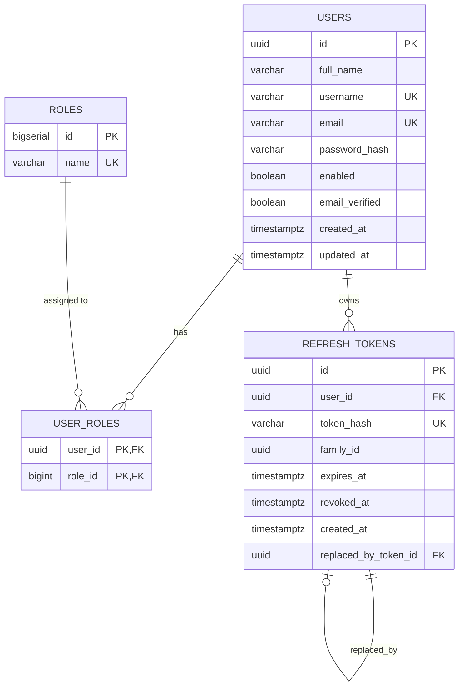

# BuildSync — Backend Authentication System Architecture & Design

## 1. Overview & Architectural Philosophy

BuildSync is a full-stack developer collaboration platform. The authentication system implemented in **Phase 2, Part 1** provides a secure, stateless, production-ready foundation built with **Spring Security**, **OAuth2 Resource Server (Nimbus JWT)**, and **PostgreSQL 17**.

The authentication architecture separates concerns across three clear boundaries:
1. **Stateless Access (JWT)**: Cryptographically signed HS256 tokens for rapid, scalable request authentication without querying the database on every HTTP request.
2. **Persistent Session Integrity (Refresh Tokens)**: Opaque, cryptographically random tokens stored only as SHA-256 hashes in PostgreSQL, secured with token rotation and reuse detection.
3. **Transport Security**: Delivered to clients through `HttpOnly`, `SameSite=Lax`, configurable `Secure` cookies with path restricted to `/api/v1/auth`.

---

## 2. Authentication Architecture

```text
  +------------------+                    +------------------------------------+
  |                  |                    |          BuildSync API             |
  |  Client Browser  |                    |       (Spring Boot 3.4.3)          |
  |                  |                    |                                    |
  +--------+---------+                    +-----------------+------------------+
           |                                                |
           |  1. POST /api/v1/auth/login                    |
           +----------------------------------------------->|  Verify credentials
           |     { email, password }                        |  via BCrypt
           |                                                |
           |  2. 200 OK + JWT JSON + HttpOnly Cookie        |  Issue HS256 Access Token
           |<-----------------------------------------------+  Hash and store Refresh Token
           |     Set-Cookie: buildsync_refresh_token=...    |  in PostgreSQL
           |                                                |
           |  3. GET /api/v1/auth/me                        |
           |     Header: Authorization: Bearer <JWT>        |  Stateless signature &
           +----------------------------------------------->|  claims validation (Nimbus)
           |                                                |
           |  4. 200 OK + User Profile JSON                 |  Return User Details
           |<-----------------------------------------------+  (no database hit needed)
           |                                                |
           |  5. POST /api/v1/auth/refresh                  |
           |     Cookie: buildsync_refresh_token=...        |  Lookup SHA-256 hash in DB
           +----------------------------------------------->|  Verify expiration & active state
           |                                                |  Rotate: issue new pair
           |  6. 200 OK + New JWT + Rotated Cookie          |  Revoke previous token
           |<-----------------------------------------------+
           |                                                |
           |  7. POST /api/v1/auth/logout                   |
           |     Header: Bearer <JWT>                       |  Mark token revoked in DB
           |     Cookie: buildsync_refresh_token=...        |  Clear cookie (Max-Age=0)
           +----------------------------------------------->|
           |  8. 200 OK + Cleared Cookie Header             |
           |<-----------------------------------------------+
```

---

## 3. Database Schema & Relationships

All database migrations are handled via Flyway. The authentication tables were established in `V2__create_authentication_tables.sql`.

### Entity-Relationship Diagram



### Key Schema Characteristics
1. **`users`**:
   - `id`: UUID primary key with default generation via PostgreSQL `gen_random_uuid()`.
   - `email` & `username`: Normalized (lowercase, trimmed) with unique constraints and B-Tree indexes.
   - `password_hash`: 255-character column storing BCrypt hashes (work factor 12).
2. **`roles`**:
   - Seeded with `ROLE_USER` and `ROLE_ADMIN`.
   - Automatic assignment of `ROLE_USER` on public registration.
3. **`refresh_tokens`**:
   - `token_hash`: 64-character column storing SHA-256 hexadecimal hash. **Raw refresh tokens are never written to disk or logged.**
   - `family_id`: UUID tracking the lineage of rotated tokens to enforce reuse detection.
   - `replaced_by_token_id`: Self-referential nullable foreign key tracking successor tokens.

---

## 4. JWT Access Token Lifecycle

- **Algorithm**: HMAC-SHA256 (`HS256`).
- **Lifespan**: 15 minutes (900 seconds).
- **Issuer**: `buildsync`.
- **Subject**: User ID (UUID string).
- **Claims**:
  - `sub`: User UUID
  - `username`: Normalized username
  - `email`: Normalized email
  - `roles`: Array of granted roles (e.g., `["ROLE_USER"]`)
  - `iat`: Epoch timestamp of issuance
  - `exp`: Epoch timestamp of expiration
- **Cryptographic Key Material**:
  - Validated on application startup.
  - Requires at least 256 bits (32 bytes) of cryptographic key material; rejects insecure keys immediately.
  - Sourced from `${JWT_SECRET}`.

---

## 5. Refresh Token Lifecycle & Rotation

- **Token Generation**: 32 cryptographically random bytes generated via `java.security.SecureRandom`, encoded using URL-safe Base64 without padding.
- **Persistence**: Only the SHA-256 hash (`64` hexadecimal characters) is persisted in the database.
- **Lifespan**:
  - **Standard Session**: 7 days.
  - **Remember Me Session**: 30 days.
- **Cookie Delivery**:
  - Name: `buildsync_refresh_token`
  - `HttpOnly`: True (inaccessible to browser JavaScript, mitigating XSS token theft).
  - `SameSite`: `Lax` (protects against cross-site request forgery while preserving top-level navigation).
  - `Path`: `/api/v1/auth` (cookie is only sent to authentication endpoints, minimizing attack surface).
  - `Secure`: Configurable via `${COOKIE_SECURE:false}` (must be `true` in production with HTTPS).

### Token Rotation Flow
1. Client requests `POST /api/v1/auth/refresh` sending the `buildsync_refresh_token` cookie.
2. The server hashes the incoming token and queries PostgreSQL by `token_hash`.
3. If the token is **already revoked**:
   > [!CAUTION]
   > **Reuse Detected!** An attacker or stale client attempted to use a previously invalidated token. The system immediately revokes all tokens sharing the same `family_id` and rejects the request with HTTP 401.
4. If the token is **expired**:
   The token is marked revoked and rejected with HTTP 401.
5. If the token is **active**:
   A new refresh token is generated under the **same `family_id`**. The old token is marked revoked (`revoked_at = NOW()`) with `replaced_by_token_id` set to the new token's ID.
6. A fresh JWT access token is signed and returned in JSON; the new rotated refresh token is set in the `Set-Cookie` header.

---

## 6. API Endpoints Specification

| Method | Endpoint | Access | Description |
| :--- | :--- | :--- | :--- |
| `POST` | `/api/v1/auth/register` | Public | Registers a new developer account, hashes password, assigns `ROLE_USER`, and issues tokens. |
| `POST` | `/api/v1/auth/login` | Public | Authenticates credentials with BCrypt, returns JWT, and sets HttpOnly refresh cookie. |
| `POST` | `/api/v1/auth/refresh` | Public (Cookie) | Rotates refresh token in PostgreSQL and issues a new JWT access token. |
| `POST` | `/api/v1/auth/logout` | Protected (Bearer) | Revokes active refresh token in PostgreSQL and clears the refresh cookie. |
| `GET` | `/api/v1/auth/me` | Protected (Bearer) | Returns profile of the authenticated developer extracted strictly from JWT subject. |
| `GET` | `/api/v1/health` | Public | Health probe endpoint reporting application status and database connectivity. |

---

## 7. Security Decisions & Defense-in-Depth

1. **Stateless API Model**:
   Sessions are completely stateless (`SessionCreationPolicy.STATELESS`). CSRF protection on the REST API is unnecessary for Bearer-token-protected endpoints, and cookie-based endpoints are restricted with `SameSite=Lax` and path `/api/v1/auth`.
2. **Timing Attack & Enumeration Resistance**:
   Invalid login attempts return a uniform HTTP 401 `"Invalid email or password"` whether the email does not exist or the password does not match.
3. **No Credential Leakage**:
   `UserResponse` and all authentication DTOs explicitly exclude `passwordHash`.
4. **Subject Integrity in `/me`**:
   The current user endpoint never accepts an ID from request parameters or body. The subject is extracted strictly from the cryptographically verified JWT token claims via `@AuthenticationPrincipal Jwt jwt`.
5. **CORS Hardening**:
   Configured explicitly via Spring Security `CorsConfigurationSource` to allow only authorized development/production origins (`http://localhost:3000`), credentials enabled, and strict method whitelisting.

---

## 8. Environment Variables Reference

| Variable | Description | Default | Required in Production |
| :--- | :--- | :--- | :--- |
| `DB_URL` | PostgreSQL JDBC connection URL | `jdbc:postgresql://localhost:5432/buildsync_db` | Yes |
| `DB_USERNAME` | PostgreSQL application user | `buildsync_app` | Yes |
| `DB_PASSWORD` | PostgreSQL user password | `buildsync_dev_password` | Yes |
| `JWT_SECRET` | 256-bit cryptographic HMAC key | (Development secret fallback) | **YES** (Must be >= 32 bytes) |
| `JWT_EXPIRATION_SECONDS` | Access token lifespan | `900` (15 minutes) | No |
| `COOKIE_SECURE` | Enforce HTTPS-only transmission of cookies | `false` | **YES** (`true`) |
| `COOKIE_SAME_SITE` | Cookie SameSite policy | `Lax` | No |
| `REFRESH_TOKEN_NORMAL_DAYS` | Standard refresh token validity | `7` | No |
| `REFRESH_TOKEN_REMEMBER_ME_DAYS` | Extended refresh token validity | `30` | No |
| `CORS_ALLOWED_ORIGINS` | Permitted browser origins | `http://localhost:3000` | Yes |
| `SERVER_PORT` | Spring Boot server port | `8080` | No |

