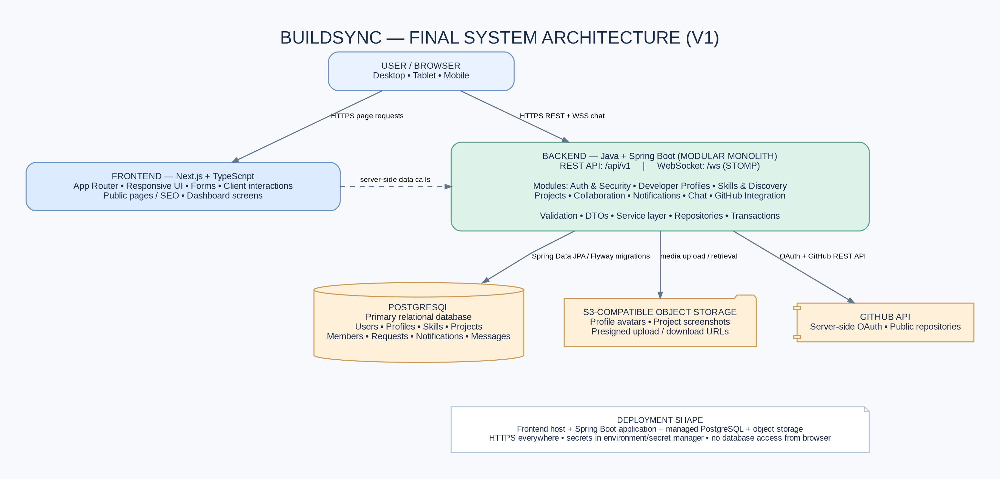
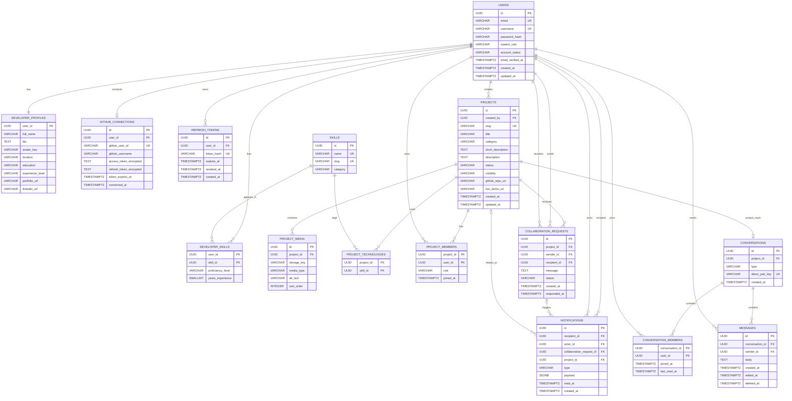

# BuildSync — System Architecture & Database Design (V1)

**Product tagline:** Bringing Developers and Projects Into Sync.  
**Product type:** Full-stack developer collaboration platform  
**Status:** Architecture and target V1 data model finalized; implementation has not started.

---

## 1. Product boundary

BuildSync helps developers create a professional profile, showcase projects, discover teammates by skills, invite people to collaborate, and communicate with accepted project teammates. GitHub integration displays a developer's public work and links repositories to BuildSync projects.

BuildSync is **not** a source-code hosting service. GitHub remains the code host; BuildSync stores project descriptions, technology tags, links and media such as screenshots.

### V1 feature set

1. Developer profiles and skill lists.
2. Public project showcase with project status and technology tags.
3. Developer discovery with text and skill filters.
4. Project-scoped collaboration invitations.
5. Notifications for invitation events.
6. Developer dashboard.
7. Project group chat, followed by direct messages between eligible collaborators.
8. GitHub account connection and public repository display.

To reduce first-release risk, build and release profiles, projects, discovery and collaboration first. Add chat and GitHub integration in subsequent increments without changing the overall architecture.

---

## 2. Final architecture decisions

| Area | Decision | Reason |
|---|---|---|
| Frontend | Next.js + TypeScript + Tailwind CSS | Responsive product UI, public pages and dashboard in one frontend. |
| Backend | Java + Spring Boot | Clear service, security, validation and persistence layers. |
| Backend style | Modular monolith | Easier to build, test and deploy than microservices; modules remain separated in code. |
| API | REST under `/api/v1` | Predictable endpoints and API versioning. |
| Real-time | Spring WebSocket + STOMP at `/ws` | Project chat and message delivery. |
| Database | PostgreSQL | Relational data and transactions suit users, projects, membership and requests. |
| ORM | Spring Data JPA / Hibernate | Java persistence and repository layer. |
| Migrations | Flyway | Version-controlled, repeatable database changes. |
| Authentication | Spring Security + short-lived JWT access token + rotating opaque refresh token | Secure API access and revocable browser sessions. |
| File storage | S3-compatible object storage | Stores avatars and project screenshots; files do not live in PostgreSQL. |
| External integration | GitHub OAuth and GitHub REST API, called by backend only | Keeps GitHub credentials out of browser code. |
| Search | PostgreSQL filtering and full-text search initially | Avoids adding a separate search service before it is needed. |
| Deployment | Separate frontend and backend deployments, managed PostgreSQL and object storage | Simple operational separation without microservices. |

**Important:** Choose a currently supported Java LTS release that is compatible with the selected Spring Boot release when implementation begins. Do not hard-code a version in this design document.

### What we are deliberately not adding in V1

- No microservices.
- No Kubernetes.
- No Redis at the beginning.
- No separate Elasticsearch/OpenSearch cluster.
- No code hosting or Git repository storage.
- No AI feature until the core product works and user feedback justifies it.

A single Spring Boot instance can use Spring's simple WebSocket broker for the first release. If BuildSync later runs multiple backend instances, introduce a shared broker such as RabbitMQ or a suitable messaging infrastructure and review WebSocket session routing.

---

## 3. System architecture diagram



### Request and data flow

1. A user opens the Next.js application in a browser.
2. Next.js renders public pages and the authenticated application interface.
3. The browser communicates with Spring Boot over HTTPS for REST operations and WSS for chat.
4. Next.js server-side rendering may also call the Spring Boot API for page data.
5. Spring Boot validates the request, checks authorization, executes business logic and uses repositories to access PostgreSQL.
6. Spring Boot issues short-lived upload instructions for object storage; file bytes are uploaded to object storage rather than stored in the database.
7. GitHub OAuth callbacks and GitHub API calls are handled by the backend.

**The browser never connects directly to PostgreSQL, and the frontend never receives a GitHub access token.**

---

## 4. Backend module structure

Keep one deployable Spring Boot application, separated into business modules:

```text
backend/src/main/java/com/buildsync/
├── auth/                 # Registration, login, refresh, logout, JWT
├── user/                 # User account and account status
├── profile/              # Developer profile and profile media
├── skill/                # Skill catalogue and developer skills
├── project/              # Project CRUD, media and project technologies
├── discovery/             # Developer and project search/filtering
├── collaboration/         # Invitations, acceptance and membership
├── notification/          # In-app notifications and read state
├── chat/                  # Conversations, members, messages, WebSocket
├── integration/github/    # GitHub OAuth and API client
└── common/                # Shared errors, config, validation and utilities
```

Within each module, use a consistent structure such as `controller`, `service`, `repository`, `entity` and `dto` where useful. Keep controllers thin. Put business rules in services. Do not return JPA entities directly from REST controllers; use request and response DTOs.

---

## 5. Database ER diagram


The diagram is the target V1 schema. Tables can be introduced through staged Flyway migrations as each feature is implemented; it is not necessary to create every table in the first migration.

### Editable Mermaid ER diagram

The Mermaid source below is included so the ERD can be edited and previewed in tools that support Mermaid.



---

## 6. Table responsibilities and important rules

### Identity and developer profile

**`users`** — Login identity, normalized email, username, password hash, system role and account status. Create a profile row when a user registers so every account has a profile record, even if the profile is incomplete.

**`developer_profiles`** — Public-facing details such as full name, bio, avatar storage key, location, education, experience level and portfolio links. `user_id` is both the primary key and a foreign key to `users.id`, enforcing one profile per user.

**`skills`** — Shared catalogue of technologies and competencies. Use categories such as `LANGUAGE`, `FRAMEWORK`, `DATABASE`, `TOOL`, `DESIGN` and `OTHER`. The same catalogue is used for a developer's skills and a project's technology stack to avoid duplicate technology lists.

**`developer_skills`** — Many-to-many link between users and skills, with proficiency and optional years of experience. Composite primary key: `(user_id, skill_id)`.

**`github_connections`** — Optional one-to-one GitHub connection. Store the GitHub account ID and username plus encrypted tokens. Tokens are private credentials and must never be returned in API responses.

**`refresh_tokens`** — Store only a hash of each opaque refresh token, not the raw token. Support expiry, rotation and revocation on logout or suspicious activity.

### Projects and membership

**`projects`** — Project description, category, status, visibility and links to a GitHub repository or live demo. `created_by` records the original creator. It is not the current owner field.

**`project_media`** — Screenshot and other media metadata. Store an object-storage key, not image bytes. Generate a public/CDN or short-lived signed URL when returning media to a client.

**`project_technologies`** — Many-to-many link between projects and the shared `skills` catalogue. Composite primary key: `(project_id, skill_id)`.

**`project_members`** — Team membership. Includes the project owner as a member with role `OWNER`; other collaborators have role `MEMBER`. This avoids a second, conflicting `owner_id` field in `projects`. A project must have exactly one active owner; enforce at most one with a partial unique index and enforce the existence of one owner in the project creation/transfer transaction.

### Collaboration and notifications

**`collaboration_requests`** — Project-scoped invitation. `sender_id` is the user who sends it; `recipient_id` is the invited developer. For V1, only the current project owner can send an invitation. The recipient can accept or reject it; the sender can cancel a pending request.

**`notifications`** — In-app notifications for received invitations, accepted/rejected requests and relevant project events. `actor_id`, `project_id` and `collaboration_request_id` may be nullable for system or other event types. `payload` is small JSONB metadata for display; it is not a replacement for relational business data.

### Chat

**`conversations`** — Supports `PROJECT` rooms and `DIRECT` conversations. A project room has a non-null `project_id` and a unique project association. A direct conversation has a null `project_id` and a canonical `direct_pair_key` based on the two sorted user IDs; this prevents duplicate direct conversations for the same pair.

**`conversation_members`** — Users allowed to read and participate in a conversation. Composite primary key: `(conversation_id, user_id)`. `last_read_at` supports unread counts.

**`messages`** — Persisted message body and timestamps. Retrieve history through paginated REST endpoints; use WebSocket only for live delivery. A message sender must be a member of the conversation.

---

## 7. Required database constraints and indexes

Apply these in Flyway migrations as the relevant tables are introduced.

1. Unique normalized email and username. Normalize to lowercase on write and/or use unique indexes on `lower(email)` and `lower(username)`.
2. Unique normalized skill name and slug.
3. Unique project slug.
4. Composite primary keys on `developer_skills`, `project_technologies`, `project_members` and `conversation_members`.
5. Partial unique index on `project_members(project_id) WHERE role = 'OWNER'` to allow at most one owner per project.
6. Partial unique index on `collaboration_requests(project_id, recipient_id) WHERE status = 'PENDING'` to prevent duplicate pending invitations.
7. Index `developer_skills(skill_id, user_id)` to support skill-based developer search.
8. Index `project_members(user_id)` for a developer's project list.
9. Index `collaboration_requests(recipient_id, status, created_at)` and `collaboration_requests(sender_id, created_at)` for request inbox/outbox views.
10. Index `notifications(recipient_id, read_at, created_at DESC)` for the notification centre.
11. Index `messages(conversation_id, created_at DESC, id DESC)` for cursor-based chat history.
12. Unique `conversations(project_id)` for project rooms and unique `conversations(direct_pair_key)` for direct conversations. PostgreSQL permits multiple nulls in a normal unique constraint, which is useful here.
13. Add database check constraints for known statuses, roles, experience levels, visibility and conversation types.
14. Add indexes on foreign-key columns used in frequent lookups; PostgreSQL does not automatically create an index for every referencing foreign key.

For `conversations`, enforce this shape with a check constraint:

```sql
CHECK (
  (type = 'PROJECT' AND project_id IS NOT NULL AND direct_pair_key IS NULL)
  OR
  (type = 'DIRECT' AND project_id IS NULL AND direct_pair_key IS NOT NULL)
)
```

For requests, disallow self-invites with `CHECK (sender_id <> recipient_id)`. Application services must also verify that the sender is the current project owner and the recipient is not already a project member.

---

## 8. Core business workflows and transactions

### Create a project

In one database transaction:

1. Insert the project with `created_by` set to the authenticated user.
2. Insert the creator into `project_members` with role `OWNER`.
3. Create the project's `PROJECT` conversation.
4. Insert the owner into `conversation_members`.
5. Insert the project technology links.

This means every project has a team owner and a chat room from the beginning, even before other collaborators join.

### Invite a developer

1. Verify the authenticated user is the project's current `OWNER`.
2. Verify the recipient exists, is active, is not the sender and is not already a member.
3. Insert a `PENDING` collaboration request.
4. Insert an in-app notification for the recipient.

The partial unique index prevents two pending invitations for the same project/recipient pair.

### Accept an invitation

In one transaction:

1. Verify the request belongs to the authenticated recipient and is still `PENDING`.
2. Change its status to `ACCEPTED` and set `responded_at`.
3. Insert the recipient into `project_members` with role `MEMBER`.
4. Insert the recipient into the project's `conversation_members`.
5. Notify the sender that the invitation was accepted.

Reject and cancel operations update the request status and create the appropriate notification. Repeated or stale actions must return a conflict response rather than creating duplicate memberships.

### Send a chat message

1. Authenticate the WebSocket session.
2. Verify the sender is a member of the target conversation.
3. Validate message size and content.
4. Persist the message in PostgreSQL.
5. Broadcast the saved message to authorized conversation subscribers.

Do not broadcast an unpersisted message. The REST endpoint returns older messages with cursor pagination; WebSocket handles new messages.

---

## 9. Authentication and security model

- Hash passwords with BCrypt or another Spring Security password encoder.
- Issue short-lived JWT access tokens.
- Use an opaque refresh token in a `Secure`, `HttpOnly`, appropriately `SameSite` cookie; store only its hash in `refresh_tokens` and rotate it on use.
- Keep access tokens in memory in the frontend rather than persistent browser storage.
- Protect cookie-based refresh/logout flows against CSRF.
- Configure CORS for the exact production frontend origin; do not use wildcard origins with credentials.
- Prefer frontend and API hostnames under the same site so secure cookie behavior is predictable.
- Authorize every project, profile, collaboration and conversation operation on the backend. Hiding a button in the UI is not authorization.
- Check conversation membership for both WebSocket subscriptions and message sends.
- Encrypt GitHub tokens at rest using application-managed secrets or a key-management service.
- Keep secrets in environment variables or a secret manager; never commit `.env` files or credentials.
- Validate upload type and size; use generated object keys and signed upload URLs.
- Apply rate limits to authentication, invitations and message sending.
- Use soft deactivation/account status for users rather than casually deleting records that are referenced by projects or messages.

---

## 10. API surface (initial contract)

All REST routes are versioned under `/api/v1`.

| Area | Endpoint | Purpose |
|---|---|---|
| Auth | `POST /auth/register` | Create account and profile |
| Auth | `POST /auth/login` | Authenticate |
| Auth | `POST /auth/refresh` | Rotate refresh token and issue new access token |
| Auth | `POST /auth/logout` | Revoke refresh token |
| Account | `GET /me` | Current account summary |
| Profile | `GET /developers/{username}` | Public developer profile |
| Profile | `PATCH /me/profile` | Update current profile |
| Skills | `GET /skills` | Search skill catalogue |
| Skills | `PUT /me/skills` | Replace/update current developer skills |
| Discovery | `GET /developers` | Search developers with query and skill filters |
| Projects | `POST /projects` | Create project |
| Projects | `GET /projects` | Explore/search public projects |
| Projects | `GET /projects/{slug}` | Project details |
| Projects | `PATCH /projects/{id}` | Update an authorized project |
| Collaboration | `POST /projects/{id}/collaboration-requests` | Invite a developer |
| Collaboration | `GET /me/collaboration-requests` | View sent/received invitations |
| Collaboration | `POST /collaboration-requests/{id}/accept` | Accept invitation |
| Collaboration | `POST /collaboration-requests/{id}/reject` | Reject invitation |
| Notifications | `GET /me/notifications` | Notification inbox |
| Notifications | `PATCH /me/notifications/{id}/read` | Mark notification read |
| Chat | `GET /conversations/{id}/messages` | Paginated message history |
| GitHub | `GET /integrations/github/connect` | Start OAuth flow |
| GitHub | `GET /integrations/github/callback` | Complete OAuth flow |
| GitHub | `DELETE /integrations/github/connection` | Disconnect GitHub |

WebSocket endpoint: `/ws` using STOMP. Define application destinations for sending messages and user/topic destinations for delivery. The server must authorize subscriptions and sends based on `conversation_members`.

Use consistent response DTOs, validation errors and HTTP status codes. Add pagination to developer, project, notification and message lists from the start.

---

## 11. Search, media and GitHub integration details

### Developer and project search

Start with PostgreSQL. Use indexed filters for skills, experience level, project status and visibility. Add PostgreSQL full-text search for names, bios and project descriptions. Consider `pg_trgm` or a dedicated search engine only when real usage demonstrates the need.

### Media uploads

The backend validates the request and issues a short-lived presigned upload URL. The browser uploads the image directly to object storage. The backend then stores the object key and metadata in `developer_profiles` or `project_media`. Do not store image blobs in PostgreSQL or write uploads to an ephemeral application server filesystem in production.

### GitHub

Run OAuth on the backend. Request the minimum scopes needed to display the user's public profile and repositories. Fetch repositories from the backend and cache only if rate limits or performance make caching necessary. The user can also manually provide a repository URL for a project.

---

## 12. Implementation sequence

### Milestone 1 — Foundation

- Create a monorepo with `frontend/`, `backend/` and `docs/`.
- Create Next.js application and Spring Boot application.
- Configure PostgreSQL and Flyway.
- Add health endpoint, API error format and environment configuration.
- Confirm frontend-to-backend connectivity.

### Milestone 2 — Accounts and profiles

- Registration, login, logout and refresh.
- User/profile creation and editing.
- Skills catalogue and developer skill links.
- Public developer profile page.

### Milestone 3 — Projects and discovery

- Project CRUD and project media.
- Technology tags.
- Developer search and project search.
- Dashboard summary.

### Milestone 4 — Collaboration

- Project members and owner permissions.
- Invite, accept, reject and cancel workflows.
- Notifications and dashboard request views.

### Milestone 5 — Chat and GitHub

- Project chat first, then direct messages with an eligibility rule.
- WebSocket authorization and persisted messages.
- GitHub OAuth and repository display.

### Milestone 6 — Hardening and deployment

- Unit, integration and end-to-end tests.
- Authorization and upload security review.
- Responsive UI and accessibility pass.
- Production environment, TLS, logging, backups and deployment documentation.

---

## 13. Acceptance criteria for the first usable release

The first release is ready when a user can:

1. Register, log in and maintain a developer profile.
2. Add skills and view other developer profiles.
3. Create, edit and publish a project with technologies and screenshots.
4. Search developers by skill and discover public projects.
5. Invite a developer to a project.
6. Accept or reject an invitation and see correct project membership.
7. See project and collaboration activity in the dashboard.

Chat and GitHub integration are the next release increment, but their data model and application boundaries are already accounted for in this architecture.

---

## 14. Final architecture summary

**BuildSync V1 = Next.js + TypeScript frontend, Java + Spring Boot modular-monolith backend, PostgreSQL database, Flyway migrations, Spring Security, WebSocket/STOMP chat, S3-compatible media storage and server-side GitHub integration.**

This is the selected architecture. Build the MVP in milestones, keep business rules in the backend, make every authorization decision server-side, and avoid infrastructure complexity until the product needs it.
