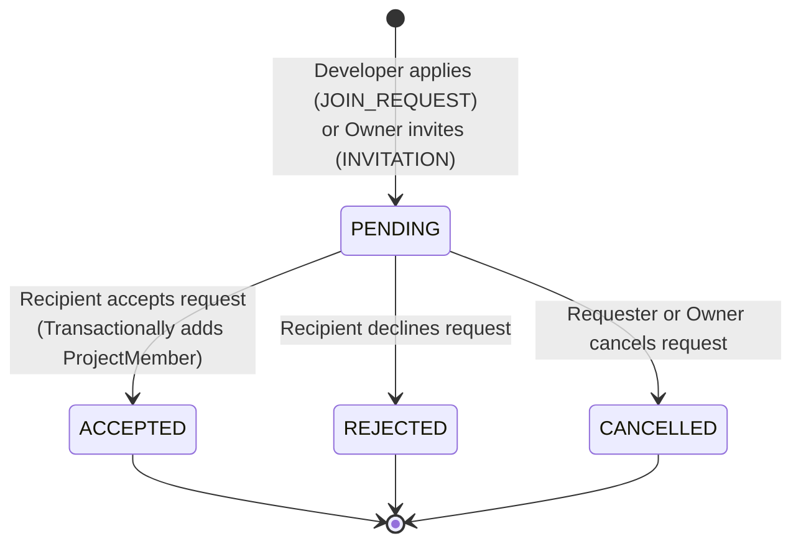

# BuildSync — Collaboration Requests & Team Management System

> **Architecture & Implementation Specification**  
> **Phase 5: Collaboration Requests & Team Management**  
> **Design Theme:** Cyber Ember Red (`#05` / `#EF4444`)  
> **Backend Stack:** Java 17, Spring Boot 3.4.3, Spring Security, Spring Data JPA, Hibernate, PostgreSQL 17, Flyway  
> **Frontend Stack:** Next.js 16.4.3, React 19, TypeScript, Tailwind CSS 4, Lucide React  

---

## 1. Executive Summary

The **Collaboration Requests & Team Management System** provides the foundational infrastructure connecting developers with projects and teams on BuildSync. It enables authenticated developers to discover open public projects and request membership, while granting project owners full governance to invite developers, review incoming join applications, assign member roles, and manage active contributors.

The implementation strictly maintains:
* **Cyber Ember Red (`#05`) design system** consistency across all UI components.
* **Transactional integrity** on all state transitions (e.g. accepting a request atomically establishes project membership).
* **Anti-enumeration privacy controls** ensuring private project team data returns `404 Not Found` to unauthorized users.
* **Strict scope isolation**: WebSocket/STOMP chat and email notifications remain designated for Phase 6.

---

## 2. Database Architecture & Flyway Migration

The database foundation is established via Flyway migration script [`V8__create_collaboration_and_team_tables.sql`](file:///d:/BUILDSYNC/backend/src/main/resources/db/migration/V8__create_collaboration_and_team_tables.sql).

### 2.1 Schema Definition

#### `project_members` Table
Represents active team memberships for a project.

```sql
CREATE TABLE project_members (
    id UUID PRIMARY KEY DEFAULT gen_random_uuid(),
    project_id UUID NOT NULL REFERENCES projects(id) ON DELETE CASCADE,
    user_id UUID NOT NULL REFERENCES users(id) ON DELETE RESTRICT,
    role VARCHAR(30) NOT NULL DEFAULT 'MEMBER',
    joined_at TIMESTAMP WITH TIME ZONE NOT NULL DEFAULT CURRENT_TIMESTAMP,
    CONSTRAINT uq_project_member UNIQUE (project_id, user_id),
    CONSTRAINT chk_project_member_role CHECK (role IN ('MEMBER', 'CONTRIBUTOR', 'MAINTAINER'))
);
```

* **Constraints & Invariants:**
  * One active membership per `(project_id, user_id)` pair.
  * `ON DELETE CASCADE` on `projects(id)` ensures that deleting a project automatically cleans up memberships without leaving orphan records.
  * `ON DELETE RESTRICT` on `users(id)` ensures user accounts cannot be deleted while active project associations exist.
  * Role constraint guarantees valid roles: `MEMBER`, `CONTRIBUTOR`, `MAINTAINER`.

#### `collaboration_requests` Table
Represents asynchronous invitations and join applications between developers and project owners.

```sql
CREATE TABLE collaboration_requests (
    id UUID PRIMARY KEY DEFAULT gen_random_uuid(),
    project_id UUID NOT NULL REFERENCES projects(id) ON DELETE CASCADE,
    requester_id UUID NOT NULL REFERENCES users(id) ON DELETE CASCADE,
    recipient_id UUID NOT NULL REFERENCES users(id) ON DELETE CASCADE,
    type VARCHAR(30) NOT NULL,
    status VARCHAR(30) NOT NULL DEFAULT 'PENDING',
    message VARCHAR(1000),
    created_at TIMESTAMP WITH TIME ZONE NOT NULL DEFAULT CURRENT_TIMESTAMP,
    updated_at TIMESTAMP WITH TIME ZONE NOT NULL DEFAULT CURRENT_TIMESTAMP,
    CONSTRAINT chk_collaboration_type CHECK (type IN ('JOIN_REQUEST', 'INVITATION')),
    CONSTRAINT chk_collaboration_status CHECK (status IN ('PENDING', 'ACCEPTED', 'REJECTED', 'CANCELLED')),
    CONSTRAINT chk_collaboration_participants CHECK (requester_id <> recipient_id)
);
```

* **Partial Unique Indexes for Concurrency & Invariant Enforcement:**
  To guarantee at the database engine level that no duplicate pending requests can exist simultaneously:

  ```sql
  -- Prevents duplicate pending join requests from the same user for a project:
  CREATE UNIQUE INDEX uq_pending_join_request 
      ON collaboration_requests (project_id, requester_id) 
      WHERE status = 'PENDING' AND type = 'JOIN_REQUEST';

  -- Prevents duplicate pending invitations to the same recipient for a project:
  CREATE UNIQUE INDEX uq_pending_invitation 
      ON collaboration_requests (project_id, recipient_id) 
      WHERE status = 'PENDING' AND type = 'INVITATION';
  ```

* **Indexes for High-Performance Queries:**
  ```sql
  CREATE INDEX idx_project_members_project ON project_members(project_id);
  CREATE INDEX idx_project_members_user ON project_members(user_id);
  CREATE INDEX idx_collab_requests_recipient ON collaboration_requests(recipient_id, status);
  CREATE INDEX idx_collab_requests_requester ON collaboration_requests(requester_id, status);
  CREATE INDEX idx_collab_requests_project ON collaboration_requests(project_id, status);
  ```

---

## 3. Collaboration Request Lifecycle & State Machine



### Invariants:
1. **Self-Requests Disallowed:** A developer cannot request to join their own project, nor invite themselves (`requester_id <> recipient_id`).
2. **Existing Membership Protection:** A user who is already the project owner or an active team member cannot submit a join request or receive an invitation.
3. **Private Project Visibility:** Join requests are strictly prohibited on `PRIVATE` projects. Non-members cannot request to join private projects.
4. **Idempotency & Concurrency:** Once a request enters a terminal state (`ACCEPTED`, `REJECTED`, `CANCELLED`), subsequent attempts to accept, reject, or cancel fail with HTTP `400 Bad Request`.
5. **Atomic Membership Creation:** When `POST /api/v1/collaborations/{requestId}/accept` is invoked, Spring's `@Transactional` boundary guarantees that creating the `ProjectMember` record and transitioning the `CollaborationRequest` status to `ACCEPTED` occur atomically.

---

## 4. Backend REST API Reference

All endpoints are hosted under `/api/v1` and secured with JWT Bearer authentication where indicated.

### 4.1 Join Requests & Invitations

| Method | Endpoint | Authorization | Description |
|---|---|---|---|
| `POST` | `/api/v1/projects/{projectId}/join-requests` | Authenticated | Developer requests to join a public project |
| `POST` | `/api/v1/projects/{projectId}/invitations` | Project Owner | Owner invites a registered developer |
| `GET` | `/api/v1/projects/{projectId}/pending-requests` | Project Owner | Owner inspects pending join requests for project |

#### Example: Submit Join Request
* **Endpoint:** `POST /api/v1/projects/{projectId}/join-requests`
* **Request Body:**
  ```json
  {
    "message": "I would love to contribute to your distributed worker orchestration system."
  }
  ```
* **Response (HTTP 201 Created):**
  ```json
  {
    "id": "76159ba5-0a95-46eb-8e5e-be809ad2b694",
    "type": "JOIN_REQUEST",
    "status": "PENDING",
    "message": "I would love to contribute to your distributed worker orchestration system.",
    "project": {
      "id": "277e3831-7b79-43c2-a8c6-a67b2d1d07c0",
      "title": "Open Cloud Platform",
      "slug": "open-cloud-platform",
      "shortDescription": "Scalable open-source cloud orchestration",
      "status": "IN_PROGRESS",
      "category": "DEVOPS",
      "ownerUsername": "alice_owner"
    },
    "requester": {
      "id": "bb6df78d-e64d-4ba6-99e5-e6e2ae2d14cb",
      "username": "bob_builder",
      "fullName": "Bob Builder",
      "avatarUrl": "/api/v1/media/avatars/bob.png",
      "headline": "Systems Engineer"
    },
    "recipient": {
      "id": "e0fc48fb-4556-4258-86d1-72944b58498f",
      "username": "alice_owner",
      "fullName": "Alice Architect",
      "avatarUrl": "/api/v1/media/avatars/alice.png",
      "headline": "Cloud Architect"
    },
    "createdAt": "2026-11-03T06:28:40.123Z",
    "updatedAt": "2026-11-03T06:28:40.123Z"
  }
  ```

#### Example: Owner Invites Developer
* **Endpoint:** `POST /api/v1/projects/{projectId}/invitations`
* **Request Body:**
  ```json
  {
    "inviteeUsername": "bob_builder",
    "message": "We would love to have your Kubernetes expertise on our cloud core."
  }
  ```
* **Response (HTTP 201 Created):** Same format as above, with `type: "INVITATION"`.

---

### 4.2 Collaboration Dashboard Management

| Method | Endpoint | Authorization | Description |
|---|---|---|---|
| `GET` | `/api/v1/collaborations/incoming?page=0&size=10` | Authenticated | Paginated incoming requests for current user |
| `GET` | `/api/v1/collaborations/outgoing?page=0&size=10` | Authenticated | Paginated outgoing requests sent by current user |
| `POST` | `/api/v1/collaborations/{requestId}/accept` | Recipient | Accept invitation or join request |
| `POST` | `/api/v1/collaborations/{requestId}/reject` | Recipient | Decline request |
| `POST` | `/api/v1/collaborations/{requestId}/cancel` | Requester or Owner | Cancel pending request |
| `GET` | `/api/v1/collaborations/my-teams` | Authenticated | Retrieve all projects where user is owner or member |

#### Example: Paginated Incoming Requests
* **Endpoint:** `GET /api/v1/collaborations/incoming?page=0&size=10`
* **Response (HTTP 200 OK):**
  ```json
  {
    "content": [
      {
        "id": "76159ba5-0a95-46eb-8e5e-be809ad2b694",
        "type": "JOIN_REQUEST",
        "status": "PENDING",
        "message": "I would love to contribute to your distributed worker orchestration system.",
        "project": {
          "id": "277e3831-7b79-43c2-a8c6-a67b2d1d07c0",
          "title": "Open Cloud Platform",
          "slug": "open-cloud-platform",
          "category": "DEVOPS",
          "status": "IN_PROGRESS",
          "ownerUsername": "alice_owner"
        },
        "requester": {
          "id": "bb6df78d-e64d-4ba6-99e5-e6e2ae2d14cb",
          "username": "bob_builder",
          "fullName": "Bob Builder",
          "avatarUrl": "/api/v1/media/avatars/bob.png",
          "headline": "Systems Engineer"
        },
        "recipient": {
          "id": "e0fc48fb-4556-4258-86d1-72944b58498f",
          "username": "alice_owner",
          "fullName": "Alice Architect"
        },
        "createdAt": "2026-11-03T06:28:40.123Z",
        "updatedAt": "2026-11-03T06:28:40.123Z"
      }
    ],
    "page": 0,
    "size": 10,
    "totalElements": 1,
    "totalPages": 1,
    "last": true
  }
  ```

---

### 4.3 Team Membership Management

| Method | Endpoint | Authorization | Description |
|---|---|---|---|
| `GET` | `/api/v1/projects/{projectId}/members` | Public / Authorized | List members (public for public projects; 404 if unauthorized on private) |
| `DELETE` | `/api/v1/projects/{projectId}/members/{userId}` | Project Owner | Owner removes a member from the team |
| `POST` | `/api/v1/projects/{projectId}/leave` | Team Member | Member voluntarily leaves the project team (Owner cannot leave) |

#### Example: List Project Members
* **Endpoint:** `GET /api/v1/projects/{projectId}/members`
* **Response (HTTP 200 OK):**
  ```json
  [
    {
      "id": "31415926-5358-9793-2384-626433832795",
      "projectId": "277e3831-7b79-43c2-a8c6-a67b2d1d07c0",
      "user": {
        "id": "bb6df78d-e64d-4ba6-99e5-e6e2ae2d14cb",
        "username": "bob_builder",
        "fullName": "Bob Builder",
        "avatarUrl": "/api/v1/media/avatars/bob.png",
        "headline": "Systems Engineer"
      },
      "role": "MEMBER",
      "joinedAt": "2026-11-03T06:29:10.456Z"
    }
  ]
  ```

#### Example: My Teams
* **Endpoint:** `GET /api/v1/collaborations/my-teams`
* **Response (HTTP 200 OK):**
  ```json
  [
    {
      "projectId": "277e3831-7b79-43c2-a8c6-a67b2d1d07c0",
      "title": "Open Cloud Platform",
      "slug": "open-cloud-platform",
      "category": "DEVOPS",
      "status": "IN_PROGRESS",
      "role": "OWNER",
      "isOwner": true,
      "joinedAt": "2026-11-03T06:20:00.000Z",
      "memberCount": 2,
      "owner": {
        "id": "e0fc48fb-4556-4258-86d1-72944b58498f",
        "username": "alice_owner",
        "fullName": "Alice Architect"
      }
    }
  ]
  ```

---

## 5. Security & Authorization Matrix

| Action | Allowed Roles / Users | HTTP Failure Response |
|---|---|---|
| Request to Join Public Project | Authenticated non-owner, non-member | `400 Bad Request` if owner/member/duplicate |
| Request to Join Private Project | None | `400 Bad Request` ("Cannot request to join private project") |
| Send Team Invitation | Project Owner only | `403 Forbidden` if not owner; `400` if already member |
| Accept / Reject Request | Intended Recipient only | `403 Forbidden` if not recipient |
| Cancel Request | Requester OR Project Owner | `403 Forbidden` if third party |
| List Members of Public Project | Anyone (authenticated or anonymous) | `200 OK` |
| List Members of Private Project | Project Owner or Active Member | `404 Not Found` (anti-enumeration privacy) |
| Remove Member | Project Owner only | `403 Forbidden` if not owner; `400` if removing owner |
| Leave Project | Active Team Member | `400 Bad Request` if user is project owner |

---

## 6. Frontend Architecture & User Experience

### 6.1 Collaborations Dashboard (`/collaborations`)
* **Tabs Navigation:**
  * **Incoming Requests:** Displays requests where the authenticated user is the recipient (incoming invitations or applications to join owned projects). Shows pending badge count, requester profile card, message quote, contextual project link, and one-click "Accept & Sync" / "Decline" buttons.
  * **Outgoing Applications:** Tracks applications sent to other projects and invitations sent to developers. Displays status tags (`PENDING`, `ACCEPTED`, `REJECTED`, `CANCELLED`) with instant "Cancel Request" capability for pending entries.
  * **My Teams:** Lists all projects where the user is an owner or active member, with role badges, member counts, project status, and quick-navigation links.
* **Loading & Empty States:** Fully animated pulse skeletons during data hydration and custom empty states for every tab.

### 6.2 Project Team Section (`/projects/[projectId]`)
* **Dedicated Team Showcase:** Shows project founder/owner alongside all active team members with avatar, full name, username, and role badge (`MAINTAINER`, `CONTRIBUTOR`, `MEMBER`).
* **Owner Administration:**
  * "Invite Teammate" modal with username validation and custom message.
  * "Pending Requests" badge button opening a dedicated modal to accept or decline incoming join requests.
  * "Remove Member" button with safety confirmation dialog.
* **Member Action:** "Leave Project" button with confirmation dialog.
* **Visitor Action:** "Request to Join" button (for public projects) opening an application modal with personal note.

### 6.3 Public Developer Profile (`/developers/[username]`)
* **"Request Collaboration" / "Invite to Project" Flow:**
  * Authenticated project owners can invite developers directly from their public profile.
  * Automatically fetches the owner's projects (`projectService.getMyProjects()`).
  * If the owner has no projects, prompts them to create one with a direct link.
  * Submits an atomic invitation via `collaborationService.inviteDeveloper`.

---

## 7. Testing & Verification

### 7.1 Backend Test Coverage
* **`CollaborationControllerIntegrationTest`**: 22 comprehensive integration tests covering:
  1. `createJoinRequest_PublicProject_Success` (201 Created)
  2. `createJoinRequest_PrivateProject_ReturnsBadRequest` (400 Bad Request)
  3. `createJoinRequest_DuplicatePending_ReturnsBadRequest` (400 Bad Request)
  4. `createJoinRequest_AlreadyMember_ReturnsBadRequest` (400 Bad Request)
  5. `createJoinRequest_OwnerJoiningOwnProject_ReturnsBadRequest` (400 Bad Request)
  6. `createInvitation_Owner_Success` (201 Created)
  7. `createInvitation_NonOwner_ReturnsForbidden` (403 Forbidden)
  8. `createInvitation_DuplicatePending_ReturnsBadRequest` (400 Bad Request)
  9. `createInvitation_UserNotFound_ReturnsNotFound` (404 Not Found)
  10. `acceptJoinRequest_ByOwner_SuccessAndCreatesMember` (200 OK + Member created)
  11. `acceptInvitation_ByInvitee_SuccessAndCreatesMember` (200 OK + Member created)
  12. `acceptRequest_ByUnauthorizedUser_ReturnsForbidden` (403 Forbidden)
  13. `acceptTwice_Rejected` (400 Bad Request)
  14. `rejectRequest_Success` (200 OK)
  15. `cancelRequest_ByRequester_Success` (200 OK)
  16. `cancelRequest_ByOwner_Success` (200 OK)
  17. `cancelRequest_ByThirdParty_ReturnsForbidden` (403 Forbidden)
  18. `getMembers_PublicProject_Anonymous_Success` (200 OK)
  19. `getMembers_PrivateProject_Unauthorized_ReturnsNotFound` (404 Not Found anti-enumeration)
  20. `removeMember_ByOwner_Success` (204 No Content)
  21. `removeMember_ByNonOwner_ReturnsForbidden` (403 Forbidden)
  22. `leaveProject_Member_Success` (204 No Content) & `leaveProject_Owner_ReturnsBadRequest` (400 Bad Request)
* **Total Backend Tests:** **169 tests run, 0 failures, 0 errors**.
* **Packaging:** `backend-0.0.1-SNAPSHOT.jar` builds cleanly with Spring Boot repackaging.

### 7.2 Frontend Lint & Build Verification
* **ESLint:** Executed with 0 errors and 0 warnings.
* **Production Build:** `npm run build` completed successfully, pre-rendering all 17 static and dynamic routes.

