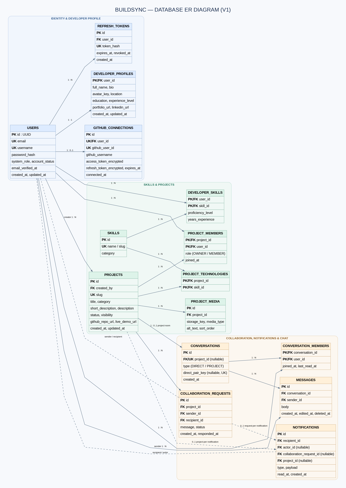
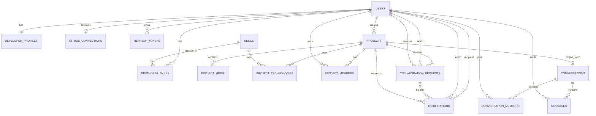

# BuildSync — Database Design & Schema Specification

**Target Database:** PostgreSQL 17  
**Migration Tool:** Flyway (`src/main/resources/db/migration/`)  
**ORM Strategy:** Hibernate 6 / Spring Data JPA (`spring.jpa.hibernate.ddl-auto: validate`)  

---

## 1. Entity-Relationship Diagram (ERD)

---

## 2. Table Specifications & Responsibilities

| Table Name | Primary Key | Key Foreign Keys | Key Responsibilities & Invariants |
|---|---|---|---|
| `users` | `id (UUID)` | None | Authentication credentials, unique email/username, system role, account status. |
| `developer_profiles`| `user_id (UUID)`| `user_id -> users(id)` | 1:1 profile details: full name, bio, avatar key, location, education, links. |
| `skills` | `id (UUID)` | None | Shared taxonomy of technical competencies (Languages, Frameworks, Tools). |
| `developer_skills` | `(user_id, skill_id)` | `users(id)`, `skills(id)` | Developer skill associations with proficiency and experience years. |
| `projects` | `id (UUID)` | `created_by -> users(id)` | Project showcase details, unique slug, visibility, repo and demo URLs. |
| `project_media` | `id (UUID)` | `project_id -> projects(id)` | Metadata and object-storage keys for screenshots and demo media. |
| `project_technologies`| `(project_id, skill_id)`| `projects(id)`, `skills(id)` | Many-to-many technology tags linking to the shared skills table. |
| `project_members` | `(project_id, user_id)`| `projects(id)`, `users(id)` | Team membership with roles (`OWNER`, `MEMBER`). Exactly one owner per project. |
| `collaboration_requests`| `id (UUID)`| `project_id`, `sender_id`, `recipient_id` | Project invitations with lifecycle states (`PENDING`, `ACCEPTED`, `REJECTED`, `CANCELLED`). |
| `notifications` | `id (UUID)` | `recipient_id`, `actor_id`, `project_id` | User in-app notifications with JSONB display payloads. |
| `conversations` | `id (UUID)` | `project_id` (nullable) | Chat rooms: either `PROJECT` room or `DIRECT` pairing. |
| `conversation_members` | `(conversation_id, user_id)` | `conversations(id)`, `users(id)` | Conversation access control and read cursors (`last_read_at`). |
| `messages` | `id (UUID)` | `conversation_id`, `sender_id` | Immutable chat message bodies and timestamps. |
| `github_connections` | `id (UUID)` | `user_id -> users(id)` | Encrypted OAuth tokens and GitHub user ID mapping. |
| `refresh_tokens` | `id (UUID)` | `user_id -> users(id)` | Opaque refresh token hashes, expiry dates, and revocation timestamps. |

---

## 3. Critical Constraints & Performance Indexes

1. **Unique Constraints:**
   - Case-insensitive uniqueness for emails and usernames: `lower(email)`, `lower(username)`.
   - Unique project slugs: `UNIQUE(slug)`.
   - Unique skills: `UNIQUE(name)`, `UNIQUE(slug)`.
2. **Partial Indexes for Business Rules:**
   - **Single Active Project Owner:**  
     `CREATE UNIQUE INDEX uq_project_single_owner ON project_members(project_id) WHERE role = 'OWNER';`
   - **No Duplicate Pending Invites:**  
     `CREATE UNIQUE INDEX uq_pending_collaboration_request ON collaboration_requests(project_id, recipient_id) WHERE status = 'PENDING';`
3. **Lookup & Filter Indexes:**
   - Skill-based developer search: `INDEX idx_developer_skills_lookup (skill_id, user_id)`
   - Inbox query optimization: `INDEX idx_requests_inbox (recipient_id, status, created_at DESC)`
   - Notification ordering: `INDEX idx_notifications_unread (recipient_id, read_at, created_at DESC)`
   - Chat history pagination: `INDEX idx_messages_cursor (conversation_id, created_at DESC, id DESC)`

---

## 4. Staged Migration Strategy (Flyway)

To avoid breaking schema changes and promote maintainability, migrations are added incrementally per milestone:
- **Phase 1 (Foundation):** Set up Flyway runtime validation and baseline connection verification.
- **Phase 2 (Auth & Profiles):** `V1__init_auth_and_profiles.sql` (users, developer_profiles, skills, developer_skills, refresh_tokens).
- **Phase 3 (Projects):** `V2__init_projects_and_media.sql` (projects, project_media, project_technologies, project_members).
- **Phase 4 (Collaboration):** `V3__init_collaboration_and_notifications.sql`.
- **Phase 5 (Chat & Integrations):** `V4__init_chat_and_github.sql`.
