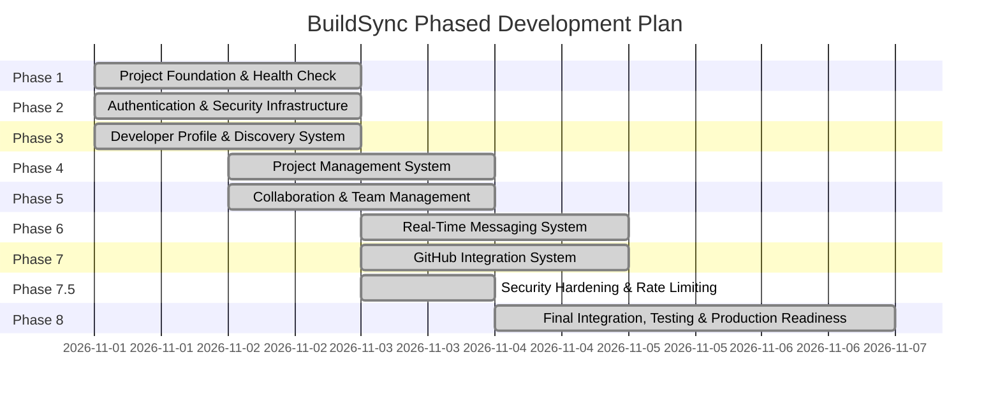

# BuildSync — Development Roadmap

**Engineering Methodology:** Phased Incremental Delivery  
**Current Phase:** Phase 1 — Project Foundation  

---

## Roadmap Overview

---

## Milestone Breakdown

### Phase 1: Project Foundation (Current)
- **Objective:** Establish a connected development ecosystem between Next.js, Spring Boot, and PostgreSQL.
- **Deliverables:**
  - Standardized monorepo directory structure (`frontend/`, `backend/`, `database/`, `docs/`).
  - Next.js 15 (TypeScript + Tailwind CSS + App Router) initialized.
  - Spring Boot 3 (Java 17 + Maven Wrapper) modular monolithic backend.
  - PostgreSQL 17 database connection (`buildsync_db`, `buildsync_app` user).
  - Actuator and custom `/api/v1/health` verification endpoint.
  - Swagger UI / OpenAPI documentation at `/swagger-ui/index.html`.
  - Frontend status dashboard connected to live backend health endpoint with CORS.
  - Automated builds verified (`npm run build` and `mvnw test package`).

### Phase 2: Authentication & Developer Profiles
- **Objective:** Secure user onboarding and identity management.
- **Deliverables:**
  - Spring Security with BCrypt password hashing.
  - JWT access tokens and HttpOnly rotating refresh token endpoints (`/api/v1/auth/*`).
  - `users` and `developer_profiles` schema via Flyway (`V1__init_auth_and_profiles.sql`).
  - Skills catalogue API and developer skill assignment.
  - Next.js authentication context, sign up, login, and public `/developers/[username]` pages.

### Phase 3: Developer Profile & Media Management System
- **Status:** Completed (Parts 1-5 Complete)
- **Objective:** Enable developers to build comprehensive professional profiles, manage skills, credentials, media assets, and discover teammates through multi-criteria search.
- **Deliverables:**
  - `developer_profiles` schema and APIs (`V3__create_developer_profile_tables.sql`).
  - Frontend profile creation, editor, and public developer showcase views (`/profile`, `/profile/edit`, `/developers/[username]`).
  - Master technical skills catalogue and profile skill assignments (`V4__create_profile_skills_education_experience.sql`).
  - Structured academic education history and professional work experience tracking.
  - Pluggable media storage service (`StorageService`, `FileSystemStorageService`) for avatars.
  - Avatar management schema (`V5__add_avatar_url_to_developer_profiles.sql`).
  - Deep image validation (magic bytes, dimensions, 5 MB limit, corruption detection).
  - Secure profile avatar APIs (`POST /api/v1/profiles/me/avatar`, `DELETE /api/v1/profiles/me/avatar`).
  - Public controlled media streaming endpoint (`GET /api/v1/media/avatars/{filename}`).
  - Next.js avatar upload and preview component with Cyber Ember Red (`#05`) styling.
  - Developer search indexing schema (`V6__add_developer_search_indexes.sql`).
  - Public discovery endpoint (`GET /api/v1/profiles`) with multi-criteria filtering (keyword, skill, experience, availability, location, sorting, pagination).
  - Anti-duplication subquery specification preventing Cartesian joins and N+1 queries.
  - Next.js `/developers` discovery page with debounced search, popular skill chips, skeleton loading, and pagination controls.
  - Comprehensive documentation in `docs/DEVELOPER_DISCOVERY.md`.

### Phase 4: Project Management System
- **Status:** Completed
- **Objective:** Comprehensive project management, technology stack tagging, privacy governance, and project showcase.
- **Deliverables:**
  - Database migration `V7__create_project_management_tables.sql` defining `projects` and `project_technologies` with strict check constraints and 9 performance B-tree indexes.
  - Domain model (`Project`, `ProjectTechnology`, `ProjectCategory`, `ProjectStatus`, `ProjectVisibility`).
  - Repository layer with `JpaSpecificationExecutor` and batch fetch queries eliminating N+1 queries.
  - Dynamic JPA Specification query builder with case-insensitive search, technology subqueries, category/status filters, and strict `visibility = PUBLIC` constraints.
  - Secure service layer (`ProjectService`) enforcing owner identity via JWT subject, slug generator, and anti-enumeration privacy (returning 404 for private projects).
  - REST controller (`ProjectController` at `/api/v1/projects`) exposing Create, My Projects, Details, Update, Delete, Public Browse, and Technologies endpoints with OpenAPI documentation.
  - Next.js 16 frontend integration:
    - `/projects`: Dashboard with Explore and My Projects tabs, 350ms debounced search, category/status/sort filters, Cyber Ember pulse skeletons, and pagination.
    - `/projects/create`: Interactive project creation form with dynamic master skills catalogue selector, URL validation, and date chronology checks.
    - `/projects/[projectId]`: Detailed project showcase with owner profile card, technology tags, external repo/demo links, and owner-only Edit/Delete controls.
    - `/projects/[projectId]/edit`: Dedicated project editor pre-populated with existing data and ownership verification guard.
  - Full test suite covering CRUD, authorization, privacy, validations, and pagination.
  - Comprehensive architectural documentation in `docs/PROJECT_MANAGEMENT.md`.

### Phase 5: Collaboration Requests & Team Management
- **Status:** Completed
- **Objective:** Enable project collaboration requests, team invitations, member management, and role assignments.
- **Deliverables:**
  - Database schema (`V8__create_collaboration_and_team_tables.sql`) defining `project_members` and `collaboration_requests` with role checks, status lifecycle checks, and partial unique indexes preventing concurrent duplicate requests.
  - 12 backend collaboration REST APIs covering join requests, team invitations, accept/reject/cancel lifecycles, project member listings, member removal, leaving projects, pending request reviews, and user teams.
  - Robust transactional integrity, concurrency guarantees, and anti-enumeration privacy safeguards (404 for unauthorized private project team access).
  - High-performance frontend `/collaborations` dashboard with Incoming Requests, Outgoing Applications, and My Teams views.
  - Interactive Project Team showcase on `/projects/[projectId]` with active members list, owner controls (invitation modal, pending requests review, member removal), member self-leave, and public request-to-join flow.
  - Integration with `/developers/[username]` public profile for inviting developers to user-owned projects.
  - 22 backend integration tests (169 total backend tests passing) and zero-error frontend production build.
  - Comprehensive architectural documentation in `docs/COLLABORATION_SYSTEM.md`.

### Phase 6: Real-Time Messaging System
- **Status:** Completed
- **Objective:** Enable instant, low-latency communication through direct 1-to-1 chats and project-scoped team collaboration rooms.
- **Deliverables:**
  - Database schema (`V9__create_messaging_and_conversation_tables.sql`) establishing `conversations`, `conversation_participants`, and `messages` with check constraints and partial unique indexes.
  - Lexicographically deterministic composite keys (`generateDirectKey`) enforcing singleton 1-to-1 conversations.
  - Spring WebSocket with STOMP message broker (`/ws`, `/topic`, `/app`, `/user`).
  - Secure STOMP authentication and authorization via `StompAuthChannelInterceptor` with JWT Bearer validation and dynamic destination RBAC.
  - Dynamic access control for project chat rooms with instant access termination upon member departure or removal.
  - 8 REST messaging endpoints for direct chat creation, conversation directory pagination, details, chronological history, REST send fallback, read receipt updates, and total unread counts.
  - Overhauled Next.js `/messages` workspace with Cyber Ember Red (`#05` / `#EF4444`) responsive UI, `@stomp/stompjs` client, optimistic UI rendering, ephemeral typing indicators, and auto-scroll.
  - Deep-link integrations from developer profiles (`/developers/[username]`), project team pages (`/projects/[projectId]`), and dynamic sidebar unread badge.
  - Comprehensive test suite of 18 messaging integration tests (187 total backend tests passing with 0 failures, 0 errors).
  - Production JAR packaging and zero-error Next.js production build (`17/17` routes compiled).
  - Comprehensive architectural documentation in `docs/REAL_TIME_MESSAGING.md`.

### Phase 7: GitHub Integration System
- **Status:** Completed
- **Objective:** Secure GitHub App user authorization, encrypted token management, repository synchronization, developer profile showcasing, and project repository linking.
- **Deliverables:**
  - **PKCE OAuth 2.0 Security:** Authorization Code Flow with PKCE (SHA-256 code challenge/verifier), cryptographically random single-use state validation, and protection against interception and authorization code replay.
  - **AES-256-GCM Token Encryption at Rest:** Dedicated cryptographic service (`TokenEncryptionService`) encrypting GitHub access and refresh tokens with unique 12-byte initialization vectors (IVs) and 128-bit authentication tags. Tokens are never exposed to browser storage, logs, or frontend responses.
  - **Expiring Token Refresh & Rotation:** Automated upstream OAuth token refresh mechanism prior to expiration, updating encrypted tokens and validity timestamps transparently.
  - **Database Migration (`V10__create_github_integration_tables.sql`):** Created `github_oauth_states`, `github_connections`, `github_repositories`, and `project_github_repositories` with check constraints, foreign keys, cascade rules, and 9 performance B-tree indexes.
  - **Unique Identity Governance:** Strict enforcement preventing a single GitHub identity from being linked across multiple BuildSync accounts.
  - **Repository Synchronization Service (`GitHubSyncService`):** Paginated import of accessible repositories, updating stars, forks, issues, language, and push timestamps idempotently without duplication.
  - **Profile Showcase & Privacy Controls:** Fine-grained showcase toggling (`PATCH /api/v1/integrations/github/repositories/{id}/showcase`) with strict privacy enforcement preventing private repositories from being showcased publicly.
  - **Project Repository Linking:** Project owners can link and unlink imported GitHub repositories to BuildSync projects (`POST` and `DELETE /api/v1/projects/{projectId}/github-repositories`), allowing team members and public viewers to inspect official source repositories.
  - **Frontend Integration (`Cyber Ember Red #05`):**
    - `/settings/integrations/github`: Dedicated GitHub management workspace with disconnect confirmation modal, sync button with loading indicator, and searchable/filterable repository directory.
    - `/settings`: Integrated "External Integrations" tab and account security quick links.
    - `/developers/[username]` & `/profile`: "GitHub Repositories" showcase tab and profile widgets rendering live repo metadata (stars, forks, languages, external links).
    - `/projects/[projectId]`: "Connected GitHub Repositories" section with "Link Repository" modal for project owners.
  - **Comprehensive Verification:** 17 automated GitHub integration tests, 204/204 total passing backend tests (0 failures, 0 errors), clean Spring Boot packaging (`backend-0.0.1-SNAPSHOT.jar`), and zero-error Next.js production build (`18/18` routes compiled).
  - **Architectural Documentation:** Full reference manual authored at `docs/GITHUB_INTEGRATION.md`.

### Phase 7.5: Security Hardening & Rate Limiting
- **Status:** Completed
- **Objective:** Centralized, production-grade rate-limiting architecture protecting REST endpoints, authentication services, media uploads, and real-time STOMP messaging with pluggable in-memory and Redis storage engines.
- **Deliverables:**
  - **Pluggable Storage SPI (`RateLimitStorage`):**
    - `InMemoryRateLimitStorage`: Thread-safe token bucket algorithm with fine-grained locks, bounded memory (`50,000` bucket threshold), automatic 1-hour inactivity TTL eviction, and injectable `Clock` for deterministic tests with zero external dependencies.
    - `RedisRateLimitStorage`: High-throughput atomic Lua script for distributed token buckets, automatic key expiration, and fail-fast startup validation preventing silent fallback.
  - **14 Configurable Rate-Limiting Policies:**
    - Authentication protection (`AUTH_LOGIN`: 10 req/5m/IP, `AUTH_REGISTER`: 5 req/h/IP, `AUTH_REFRESH`: 30 req/15m/user+IP).
    - Resource abuse prevention (`GENERAL_AUTHENTICATED`: 120 req/m/user, `GENERAL_ANONYMOUS`: 60 req/m/IP, `SEARCH_DEVELOPERS`: 60 req/m, `SEARCH_PROJECTS`: 60 req/m, `AVATAR_UPLOAD`: 10 uploads/h/user, `COLLABORATION_ACTIONS`: 20 req/m/user, `GITHUB_SYNC`: 5 sync/h/user).
    - Real-time transport & STOMP messaging protection (`WEBSOCKET_CONNECT`: 10 attempts/m/IP, `DIRECT_MESSAGING`: 30 msg/m/user, `PROJECT_GROUP_MESSAGING`: 30 msg/m/user, `TYPING_EVENTS`: 60 events/m/user).
  - **Safe Client Identity & IP Resolution (`ClientIpResolver`):** Strict anti-spoofing mode ignoring `X-Forwarded-For` by default (`TRUSTED_PROXY_ENABLED=false`), verified User UUID for authenticated sessions, and SHA-256 storage key hashing preventing identity leakage.
  - **HTTP 429 Protocol & Security Headers:** RFC-compliant `Retry-After`, `RateLimit-Limit`, `RateLimit-Remaining`, and `RateLimit-Reset` headers exposed through CORS, and standard JSON error bodies matching `GlobalExceptionHandler`.
  - **Real-Time WebSocket & STOMP Interception:** `RateLimitHandshakeInterceptor` at transport upgrade and `StompAuthChannelInterceptor` at frame level, dropping rate-exceeded frames without database persistence or broadcast.
  - **Frontend Integration (`RateLimitError`):** Upgraded `api-client.ts` parsing rate-limit headers into typed errors and preventing infinite retry storms.
  - **Comprehensive Verification:** 27 new rate-limiting automated tests (231/231 total passing backend tests), clean Spring Boot packaging (`backend-0.0.1-SNAPSHOT.jar`), and zero-error Next.js production build (`18/18` routes compiled).
  - **Architectural Documentation:** Full reference manual authored at `docs/RATE_LIMITING.md`.

### Phase 8: Final Integration, Testing & Production Readiness
- **Status:** Completed
- **Objective:** Complete full-stack application audit, comprehensive backend and frontend regression verification, production containerization, automated CI/CD pipeline, and operational deployment documentation.
- **Deliverables:**
  - **Full-Stack Application Audit:** Comprehensive review of all 18 frontend routes, REST APIs, WebSocket security, and authentication lifecycle. Fixed rate-limiting test isolation ensuring zero test suite cross-contamination.
  - **Backend Regression Suite:** 239 automated tests passing with 0 failures, 0 errors, and 0 skipped tests (`./mvnw clean test`), verifying auth, profile, project, collaboration, messaging, GitHub integration, and rate limiting.
  - **Redis Production Rate Limiting Verification:** Real TCP-backed tests (`RedisProductionRateLimitTest`) verifying atomic token consumption via Lua script, concurrent multi-threading, TTL key expiration, shared cross-node counters, and fail-fast startup validation when Redis is down.
  - **Frontend Quality & Production Build:** ESLint passing with 0 errors (`npm run lint`) and clean Next.js 16 Webpack compilation (`18/18` static and dynamic routes compiled).
  - **Production Hardened Configuration (`application-prod.yml`):** Zero default credentials, strict CORS restrictions, secure HTTPS cookies, fail-fast secrets validation, and production Redis rate limiting.
  - **Multi-Stage Docker Architecture:** Hardened containerfiles for backend (`backend/Dockerfile`) and frontend (`frontend/Dockerfile`) running as non-root users (`UID 10001`) with container health checks.
  - **Docker Compose Orchestration (`docker-compose.yml`):** Full multi-container production stack with PostgreSQL 17, Redis 7, Spring Boot backend, and Next.js frontend with isolated networking and persistent named volumes.
  - **Automated CI/CD Pipeline (`.github/workflows/ci.yml`):** Multi-job GitHub Actions workflow executing backend tests, packaging, frontend linting, and Next.js production builds with dependency caching.
  - **Operational Documentation:** Authored `docs/PRODUCTION_DEPLOYMENT.md` and `docs/GO_LIVE_CHECKLIST.md`.
