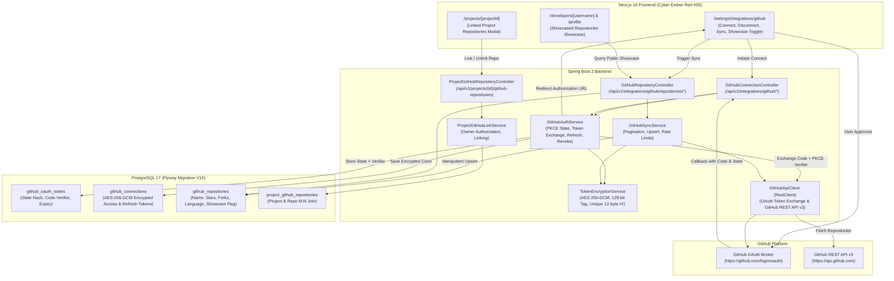
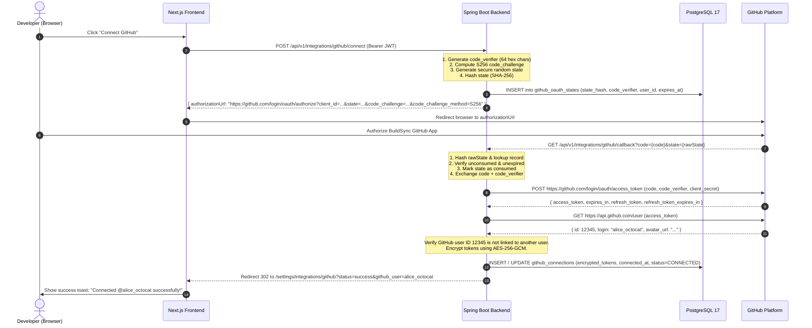

# BuildSync — GitHub Integration System Architecture & Implementation

> **BuildSync** — *Bringing Developers and Projects Into Sync.*

---

## 1. Executive Summary

Phase 7 implements the **GitHub Integration System** for BuildSync. It enables authenticated developers to link their GitHub accounts via an RFC 7636 compliant OAuth 2.0 Authorization Code Flow with PKCE (Proof Key for Code Exchange), synchronize accessible repository metadata, showcase selected open-source repositories on public developer profiles, and link official source code repositories directly to BuildSync projects.

All sensitive OAuth credentials (access and refresh tokens) are encrypted at rest using **AES-256-GCM authenticated encryption** with unique 96-bit (12-byte) initialization vectors and 128-bit authentication tags. Tokens are strictly confined to backend memory during synchronization calls and are **never transmitted to the client, logged, or exposed in local browser storage**.

---

## 2. System Architecture



---

## 3. OAuth 2.0 PKCE Flow & Cryptographic Sequence

The GitHub App authorization uses RFC 7636 PKCE (S256) to prevent code interception attacks:



---

## 4. AES-256-GCM Token Encryption at Rest

GitHub access tokens and refresh tokens are encrypted prior to database persistence using the standard authenticated cipher `AES/GCM/NoPadding`:

- **Cipher:** `AES/GCM/NoPadding` (256-bit key)
- **Key Derivation:** Sourced from `GITHUB_TOKEN_ENCRYPTION_KEY` environment variable. If hex-encoded (64 characters), it is decoded into raw 32 bytes; otherwise derived via `SHA-256(rawKeyString)`.
- **Initialization Vector (IV):** Cryptographically secure `SecureRandom` 12-byte (96-bit) IV generated fresh for **every single encryption operation**.
- **Authentication Tag:** 128-bit authentication tag appended to the ciphertext (`GCMParameterSpec(128, iv)`), guaranteeing ciphertext authenticity and preventing tampering.
- **Persistence Format:** `Base64URL(iv || ciphertext_with_tag)`.
- **Decryption Safeguard:** Before decrypting, the payload is parsed into its 12-byte IV and ciphertext/tag. Any bit modification results in an `AEADBadTagException` ("Tag mismatch!"), immediately rejecting tampered tokens.

---

## 5. Database Design & Migration (`V10`)

The database schema is defined in [`V10__create_github_integration_tables.sql`](file:///d:/BUILDSYNC/backend/src/main/resources/db/migration/V10__create_github_integration_tables.sql):

```sql
-- 1. OAuth PKCE States
CREATE TABLE github_oauth_states (
    id UUID PRIMARY KEY DEFAULT gen_random_uuid(),
    state_hash VARCHAR(64) NOT NULL UNIQUE,
    code_verifier VARCHAR(128) NOT NULL,
    user_id UUID NOT NULL REFERENCES users(id) ON DELETE CASCADE,
    expires_at TIMESTAMPTZ NOT NULL,
    consumed BOOLEAN NOT NULL DEFAULT FALSE,
    consumed_at TIMESTAMPTZ,
    created_at TIMESTAMPTZ NOT NULL DEFAULT CURRENT_TIMESTAMP
);

-- 2. GitHub Connections (1:1 with users)
CREATE TABLE github_connections (
    id UUID PRIMARY KEY DEFAULT gen_random_uuid(),
    user_id UUID NOT NULL UNIQUE REFERENCES users(id) ON DELETE CASCADE,
    github_user_id BIGINT NOT NULL UNIQUE,
    github_username VARCHAR(100) NOT NULL,
    github_avatar_url VARCHAR(500),
    github_profile_url VARCHAR(500),
    encrypted_access_token TEXT NOT NULL,
    encrypted_refresh_token TEXT,
    access_token_expires_at TIMESTAMPTZ,
    refresh_token_expires_at TIMESTAMPTZ,
    connection_status VARCHAR(30) NOT NULL DEFAULT 'CONNECTED',
    connected_at TIMESTAMPTZ NOT NULL DEFAULT CURRENT_TIMESTAMP,
    last_synced_at TIMESTAMPTZ,
    updated_at TIMESTAMPTZ NOT NULL DEFAULT CURRENT_TIMESTAMP
);

-- 3. Imported Repositories
CREATE TABLE github_repositories (
    id UUID PRIMARY KEY DEFAULT gen_random_uuid(),
    connection_id UUID NOT NULL REFERENCES github_connections(id) ON DELETE CASCADE,
    github_repo_id BIGINT NOT NULL UNIQUE,
    name VARCHAR(255) NOT NULL,
    full_name VARCHAR(255) NOT NULL,
    description TEXT,
    html_url VARCHAR(500) NOT NULL,
    is_private BOOLEAN NOT NULL DEFAULT FALSE,
    visibility VARCHAR(30) NOT NULL DEFAULT 'PUBLIC',
    default_branch VARCHAR(100),
    primary_language VARCHAR(100),
    stars_count INTEGER NOT NULL DEFAULT 0,
    forks_count INTEGER NOT NULL DEFAULT 0,
    open_issues_count INTEGER NOT NULL DEFAULT 0,
    is_showcased BOOLEAN NOT NULL DEFAULT FALSE,
    github_pushed_at TIMESTAMPTZ,
    github_updated_at TIMESTAMPTZ,
    created_at TIMESTAMPTZ NOT NULL DEFAULT CURRENT_TIMESTAMP,
    updated_at TIMESTAMPTZ NOT NULL DEFAULT CURRENT_TIMESTAMP
);

-- 4. Project Repository Linkages (M:N)
CREATE TABLE project_github_repositories (
    id UUID PRIMARY KEY DEFAULT gen_random_uuid(),
    project_id UUID NOT NULL REFERENCES projects(id) ON DELETE CASCADE,
    github_repository_id UUID NOT NULL REFERENCES github_repositories(id) ON DELETE CASCADE,
    linked_at TIMESTAMPTZ NOT NULL DEFAULT CURRENT_TIMESTAMP,
    is_showcased BOOLEAN NOT NULL DEFAULT TRUE,
    CONSTRAINT uq_project_github_repository UNIQUE (project_id, github_repository_id)
);
```

### Constraints & Indexes
- `idx_gh_states_lookup`: Composite B-tree index on `(state_hash, consumed, expires_at)`.
- `idx_gh_conns_user_id`: Unique B-tree index on `github_connections(user_id)`.
- `idx_gh_conns_gh_user_id`: Unique B-tree index on `github_connections(github_user_id)` preventing duplicate linking across different accounts.
- `idx_gh_repos_conn_showcase`: Index on `(connection_id, is_showcased)`.
- `idx_gh_repos_lang`: Index on `primary_language`.
- `idx_proj_gh_repos_proj`: Index on `project_github_repositories(project_id)`.

---

## 6. REST API Endpoints

### A. Connection Management

| Method | Endpoint | Access | Description |
|---|---|---|---|
| `POST` | `/api/v1/integrations/github/connect` | Authenticated | Generates S256 PKCE challenge, stores state record, and returns `authorizationUrl`. |
| `GET` | `/api/v1/integrations/github/callback` | Public | OAuth redirect receiver. Validates state, exchanges code with PKCE, encrypts tokens, and redirects to frontend. |
| `GET` | `/api/v1/integrations/github/status` | Authenticated | Returns connection status, GitHub username, avatar, profile URL, repo count, and token status without exposing secrets. |
| `DELETE` | `/api/v1/integrations/github/disconnect` | Authenticated | Revokes GitHub App authorization upstream (best-effort) and permanently deletes encrypted local credentials and cached repositories. |

### B. Repository Synchronization & Showcase

| Method | Endpoint | Access | Description |
|---|---|---|---|
| `POST` | `/api/v1/integrations/github/sync` | Authenticated | Imports accessible repositories from GitHub REST API v3 using paginated requests (100 per page). Performs idempotent upsert. |
| `GET` | `/api/v1/integrations/github/repositories` | Authenticated | Paginated repository query with filtering: `search`, `language`, `isPrivate`, `isShowcased`, and `sortBy` (`pushedAt`, `stars`, `updatedAt`, `name`). |
| `GET` | `/api/v1/integrations/github/repositories/{id}` | Authenticated | Fetches details for a single imported repository belonging to the caller. |
| `PATCH` | `/api/v1/integrations/github/repositories/{id}/showcase` | Authenticated | Toggles `isShowcased` flag. Enforces privacy rule: private repositories are blocked with HTTP 400. |
| `DELETE` | `/api/v1/integrations/github/repositories/{id}` | Authenticated | Removes an imported repository from local storage. |
| `GET` | `/api/v1/integrations/github/showcase/{username}` | Public | Public endpoint returning showcased repositories for the specified developer username. |

### C. Project Repository Linking

| Method | Endpoint | Access | Description |
|---|---|---|---|
| `POST` | `/api/v1/projects/{projectId}/github-repositories` | Project Owner | Links an imported repository to the project (`{ githubRepositoryId, isShowcased }`). |
| `GET` | `/api/v1/projects/{projectId}/github-repositories` | Public / Members | Lists repositories linked to the project. Private repositories are hidden from non-team members. |
| `DELETE` | `/api/v1/projects/{projectId}/github-repositories/{repositoryId}` | Project Owner | Unlinks a GitHub repository from the project. |

---

## 7. Frontend Integration & User Interfaces

1. **GitHub Settings (`/settings/integrations/github`):**
   - **Disconnected State:** Educational card outlining permissions (read metadata, public profile), security disclosures (PKCE OAuth, AES-256-GCM encryption), and prominent "Connect GitHub" button.
   - **Connected State:** Profile header displaying GitHub avatar, username, external profile link, token status badge ("Active & Synced" vs "Re-auth Required"), last synced time, and action buttons for "Sync Repositories" and "Disconnect".
   - **Repository Directory:** Real-time search filter, language dropdown, visibility filter (All, Public, Private), sorting options (Recently Pushed, Most Stars, Recently Updated, Name), pagination, and interactive "Showcase on Profile" toggle switches (disabled with tooltip for private repos).
   - **Disconnect Modal:** Confirmation dialog warning the user that disconnecting revokes credentials and removes repository cache.

2. **Main Settings (`/settings`):**
   - Added "GitHub & Integrations" tab with quick link to `/settings/integrations/github`.
   - Updated "Account & Privacy" tab with GitHub integration status and configuration button.

3. **Public Developer Profile (`/developers/[username]` & `/profile`):**
   - Added "GitHub" tab showcasing repositories selected for public showcase.
   - Highlights stars count, forks count, primary language with colored indicator, last push timestamp, and direct link to GitHub.

4. **Project Details (`/projects/[projectId]`):**
   - Added "Connected GitHub Repositories" section showcasing linked repositories.
   - Project owners can click "Link Repository" to select from imported repositories via a modal.
   - Owners can unlink repositories with a single click.

---

## 8. Security Guarantees & Privacy Rules

1. **Zero Secret Exposure:** Frontend responses, logs, and client storage NEVER receive raw or encrypted GitHub access/refresh tokens.
2. **Private Repository Protection:** Private repositories can NEVER be toggled into public showcase (`isPrivate = true` check enforced by backend service).
3. **Anti-Interception PKCE:** Code verifier generated per session using 64 cryptographically secure random bytes; code challenge hashed with SHA-256 (`S256`).
4. **Single-Use States:** OAuth states are stored with `consumed = true` upon first retrieval to prevent replay attacks.
5. **Anti-Enumeration Ownership:** Only the project owner can link or unlink repositories to/from a project. Non-members cannot view private linked repositories.
6. **Unique GitHub Identity:** A single numeric GitHub identity cannot be linked to multiple BuildSync user accounts simultaneously.

---

## 9. Verification & Quality Assurance

- **GitHub Integration Tests:** 17 comprehensive automated integration tests passing (`com.buildsync.github.GitHubIntegrationTest`).
- **Total Backend Test Suite:** 204 tests executed across all 7 project modules with **0 failures and 0 errors**.
- **Backend Packaging:** Successfully built Spring Boot executable archive (`backend-0.0.1-SNAPSHOT.jar`).
- **Frontend Quality Assurance:** ESLint verified with **0 warnings and 0 errors** (`npm run lint`).
- **Production Build:** Next.js 16 production build compiled cleanly with **all 18 static and dynamic routes** (`npm run build`).

