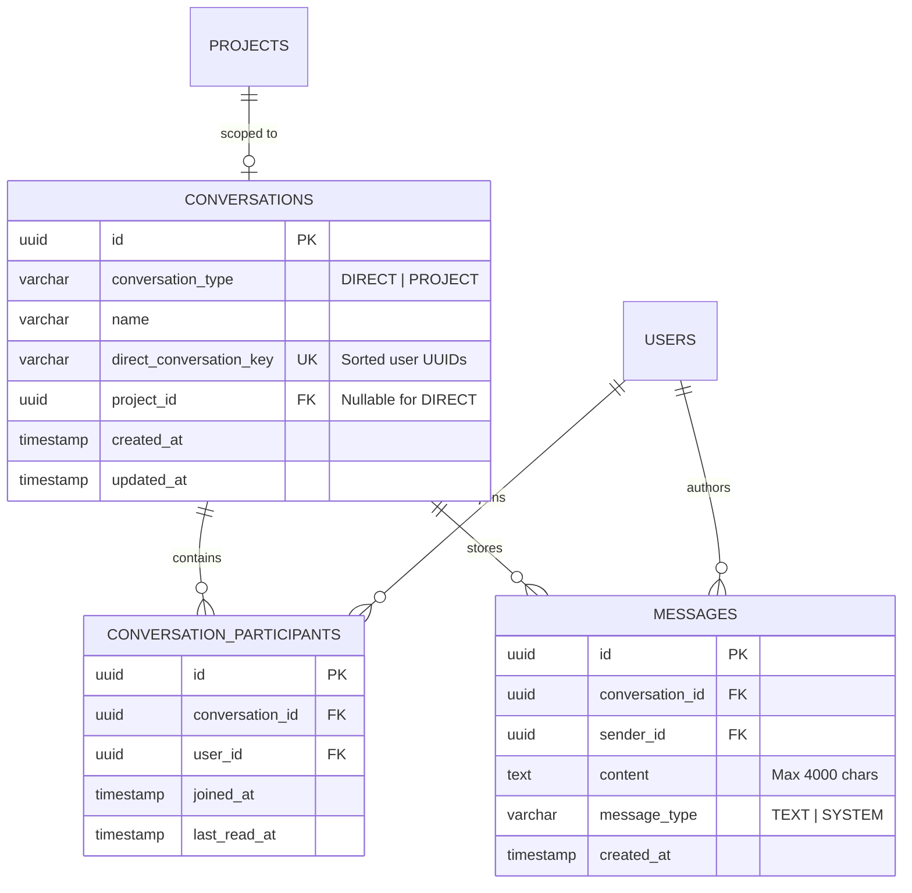
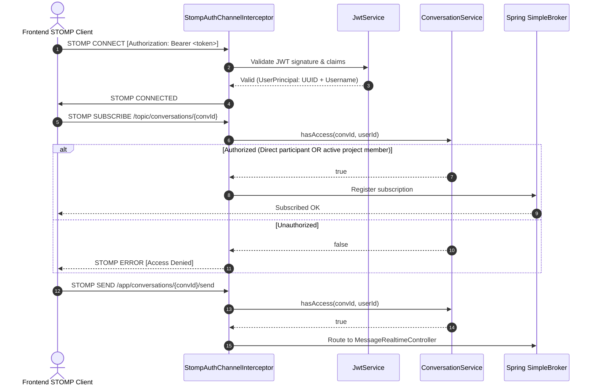
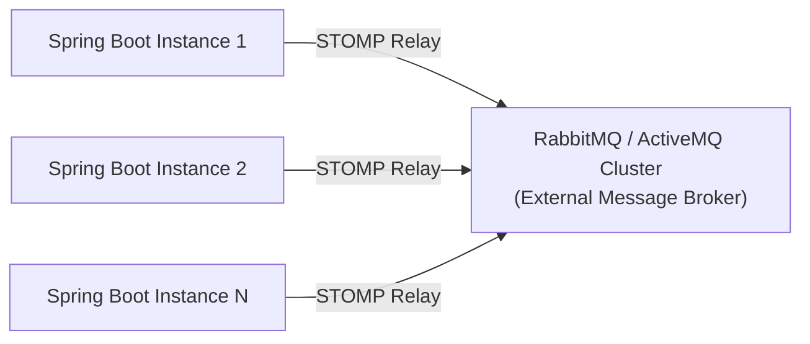

# BuildSync — Real-Time Messaging System Architecture

**Phase:** Phase 6 — Real-Time Messaging System  
**Document Version:** 1.0.0  
**Design System:** Cyber Ember Red (`#05` / `#EF4444`)  
**Stack:** Spring Boot 3.4.3, Spring WebSocket, STOMP, PostgreSQL 17, Flyway, Next.js 16.4.3, React 19, TypeScript, Tailwind CSS 4, `@stomp/stompjs 7.5.0`

---

## 1. Executive Summary & Architecture Overview

BuildSync Phase 6 introduces an enterprise-grade, low-latency **Real-Time Messaging System** that connects developers directly and powers project-scoped team communication. The messaging architecture implements a **Dual-Layer Hybrid Protocol**:

1. **Real-Time WebSocket/STOMP Protocol (`/ws`)**: High-performance, bi-directional event stream for instant message delivery, ephemeral typing indicators, and live read receipt broadcasts.
2. **Secure REST HTTP Fallback (`/api/v1/conversations/**`)**: Guaranteed transactional persistence, cursor-based chronological message history retrieval, paginated directory querying, and automatic offline/reconnecting fallback for environments blocking persistent WebSocket connections.

```mermaid
flowchart TD
    subgraph Client["Next.js 16 Frontend (React 19)"]
        UI["/messages Interface<br/>(Cyber Ember Red UI)"]
        StompClient["@stomp/stompjs Client<br/>(JWT In-Memory Bearer Auth)"]
        RestService["messagingService<br/>(REST API Client)"]
    end

    subgraph Backend["Spring Boot 3.4.3 Backend"]
        Handshake["WebSocket Handshake Handler<br/>(/ws)"]
        Interceptor["StompAuthChannelInterceptor<br/>(JWT Verification & Destination RBAC)"]
        StompController["MessageRealtimeController<br/>(/app/conversations/{id}/*)"]
        RestController["ConversationController &<br/>ProjectConversationController"]
        MsgService["MessageService & ConversationService"]
        Broker["Spring SimpleBroker<br/>(/topic/conversations/{id}/*)"]
    end

    subgraph Storage["PostgreSQL 17 Database"]
        DBConv["conversations"]
        DBPart["conversation_participants"]
        DBMsg["messages"]
        DBCollab["project_members"]
    end

    UI -->|STOMP CONNECT / SEND| StompClient
    UI -->|HTTP GET / POST| RestService
    StompClient -->|WebSocket /ws| Handshake
    Handshake --> Interceptor
    Interceptor --> StompController
    RestService --> RestController
    RestController --> MsgService
    StompController --> MsgService
    MsgService -->|Transactional Write| Storage
    MsgService -->|Broadcast Event| Broker
    Broker -->|Live Push| StompClient
```



---

## 2. Database Schema & Flyway Migration (`V9`)

The database foundation is established in [`backend/src/main/resources/db/migration/V9__create_messaging_and_conversation_tables.sql`](file:///d:/BUILDSYNC/backend/src/main/resources/db/migration/V9__create_messaging_and_conversation_tables.sql).

### 2.1 Entity Relationship Model



### 2.2 Relational Integrity & Concurrency Safeguards

1. **Singleton 1-to-1 Direct Conversations**:
   - Direct conversations compute a deterministic, lexicographically sorted composite key: `Conversation.generateDirectKey(userA, userB)`.
   - A partial unique index `uq_direct_conversation_key` on `conversations(direct_conversation_key) WHERE conversation_type = 'DIRECT'` enforces that only a single direct chat can ever exist between two developers, regardless of who initiated the conversation.
2. **Project Singleton Conversations**:
   - A partial unique index `uq_project_conversation` on `conversations(project_id) WHERE conversation_type = 'PROJECT'` guarantees exactly one shared group room per project.
3. **Optimized Cursor Indexing**:
   - `idx_messages_conversation_created` on `messages(conversation_id, created_at ASC)` provides $O(\log N)$ seeks for paginated chronological chat history without filesorts.
   - `idx_messages_unread_cursor` on `messages(conversation_id, created_at, sender_id)` allows instant index-only unread count calculations.
4. **Cascade Safety**:
   - Deleting a project cascades to its group conversation and associated messages.
   - User account deletions cascade to participant memberships while preserving system-level message provenance.

---

## 3. Real-Time STOMP & WebSocket Security

WebSocket connections in Spring Boot bypass standard HTTP servlet filters during frame transmission. BuildSync implements comprehensive, end-to-end security via [`StompAuthChannelInterceptor`](file:///d:/BUILDSYNC/backend/src/main/java/com/buildsync/messaging/websocket/StompAuthChannelInterceptor.java).



### 3.1 Security Guarantees
- **STOMP Frame Authentication**: On `CONNECT`, the Bearer token is parsed and validated using Nimbus JWT decoder. A custom `UserPrincipal` is injected into the session attributes.
- **Topic Subscription Authorization**: When a client requests subscription to `/topic/conversations/{id}`, the interceptor extracts the `conversationId` and queries `conversationService.hasAccess(conversationId, currentUserId)`. If false, an `AccessDeniedException` aborts the subscription.
- **Dynamic Project Member Revocation**: For `PROJECT` conversations, `hasAccess` verifies that the caller is either the project owner or is actively listed in `project_members`. If an owner removes a developer in Phase 5, the developer's ability to receive or send messages is immediately revoked on their next interaction.
- **Self-Conversation Prevention**: Direct conversation requests targeting oneself fail immediately with HTTP `400 Bad Request`.

---

## 4. REST API Endpoint Reference

All REST endpoints reside under `/api/v1` and require HTTP Bearer authentication.

| Method | Endpoint | Description | Status Codes |
|---|---|---|---|
| `POST` | `/api/v1/conversations/direct` | Start or retrieve existing 1-to-1 conversation with developer | `200`, `400`, `404` |
| `GET` | `/api/v1/conversations` | Paginated list of user's active conversations | `200` |
| `GET` | `/api/v1/conversations/{conversationId}` | Full metadata and participant list for conversation | `200`, `403`, `404` |
| `GET` | `/api/v1/conversations/{conversationId}/messages` | Chronological message history (`page`, `size`) | `200`, `403`, `404` |
| `POST` | `/api/v1/conversations/{conversationId}/messages` | Send message via REST fallback (persists and broadcasts) | `201`, `400`, `403` |
| `POST` | `/api/v1/conversations/{conversationId}/read` | Update participant `last_read_at` cursor & broadcast receipt | `204`, `403` |
| `GET` | `/api/v1/conversations/unread-count` | Total unread message count across all conversations | `200` |
| `GET` | `/api/v1/projects/{projectId}/conversation` | Get or create team group chat for project (members only) | `200`, `403`, `404` |

---

## 5. Frontend Architecture & Design Integration

### 5.1 Cyber Ember Red UI (`#05` / `#EF4444`)
The primary messaging workspace at [`frontend/src/app/messages/page.tsx`](file:///d:/BUILDSYNC/frontend/src/app/messages/page.tsx) adheres strictly to the approved design system:
- **Responsive Layout**: Desktop displays a two-column master-detail layout; mobile switches dynamically between the conversation directory and active conversation via `mobileChatView`.
- **Live Connection Status**: Top status badge shows an emerald pulsing indicator for `Live` STOMP connections, an amber pulse for `Connecting`, and zinc badge for `REST Fallback`.
- **Optimistic UI Reconciliation**: New messages render instantly in the UI with a subtle pending clock indicator and are reconciled in-place with zero layout shift upon WebSocket broadcast or REST response.
- **Auto-Scroll & Typing Indicator**: Auto-scrolls gracefully to bottom on new messages, debounces typing events, and displays ephemeral animated dot indicators (`@username is typing...`).
- **Deep Linking**:
  - `?conversationId={id}`: Opens specific conversation directly.
  - `?user={username}`: Automatically creates or retrieves direct conversation with target developer.
  - `?project={projectId}`: Automatically connects to project team chat room.

### 5.2 Dynamic Unread Counter
[`Sidebar.tsx`](file:///d:/BUILDSYNC/frontend/src/components/layout/Sidebar.tsx) polls `/api/v1/conversations/unread-count` on route transitions and renders a dynamic `#EF4444` notification pill with unread counts up to `99+`.

---

## 6. Enterprise Scalability & Broker Relay

In its default configuration, Spring Boot uses an in-memory `SimpleBroker`. To scale horizontally across multiple stateless application instances in production:



To enable full multi-node broker clustering, update [`WebSocketConfig.java`](file:///d:/BUILDSYNC/backend/src/main/java/com/buildsync/messaging/websocket/WebSocketConfig.java):

```java
@Override
public void configureMessageBroker(MessageBrokerRegistry config) {
    config.enableStompBrokerRelay("/topic", "/queue")
          .setRelayHost(brokerHost)
          .setRelayPort(brokerPort)
          .setClientLogin(brokerUser)
          .setClientPasscode(brokerPassword);
    config.setApplicationDestinationPrefixes("/app");
    config.setUserDestinationPrefix("/user");
}
```

---

## 7. Verification & Test Metrics

### Backend Test Suite
Executed via `./mvnw test` with JUnit 5 and Spring Boot Test:
- **Total Backend Tests:** `187`
- **Failures:** `0`
- **Errors:** `0`
- **Skipped:** `0`
- **Phase 6 Messaging Tests:** `18` passed in `MessagingIntegrationTest`:
  1. `testCreateDirectConversationSuccess`
  2. `testGetOrCreateDirectConversationIdempotent`
  3. `testDirectConversationLexicographicalIdempotency`
  4. `testDirectConversationWithSelfFails`
  5. `testDirectConversationTargetNotFound`
  6. `testProjectConversationOwnerAccess`
  7. `testProjectConversationMemberAccess`
  8. `testProjectConversationNonMemberForbidden`
  9. `testRemovedMemberLosesProjectConversationAccess`
  10. `testSendMessageViaRestSuccess`
  11. `testSendMessageExceedsMaxLengthFails`
  12. `testSendEmptyMessageFails`
  13. `testNonParticipantCannotSendMessage`
  14. `testGetMessageHistoryChronologicalOrder`
  15. `testMarkAsReadUpdatesCursorAndUnreadCount`
  16. `testStompConnectWithValidJwt`
  17. `testStompConnectWithInvalidJwtFails`
  18. `testStompSubscribeUnauthorizedDestinationFails`

### Packaging & Frontend Verification
- **Spring Boot JAR Packaging:** `./mvnw package -DskipTests` -> `backend-0.0.1-SNAPSHOT.jar` generated successfully (`BUILD SUCCESS`).
- **Frontend Linting:** `npm run lint` -> `0 problems (0 errors, 0 warnings)`.
- **Next.js Production Build:** `npm run build` -> Clean compilation of 17 static and dynamic routes with zero warnings.

