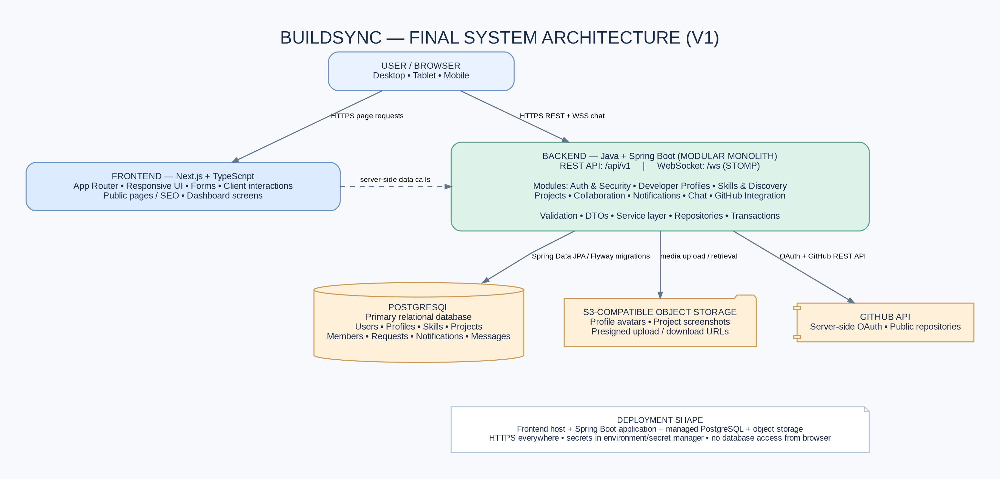

# BuildSync — System Architecture

**Architecture Style:** Decoupled Modular Monolith  
**Backend API Prefix:** `/api/v1`  
**Real-Time Channel:** `/ws` (STOMP over WebSocket)  

---

## 1. Architectural Philosophy & Strategy

BuildSync adheres to the **Modular Monolith** pattern:
- **Single Deployable Unit for Backend:** Eliminates the operational complexity, network latency, distributed transactions, and failure modes of premature microservices.
- **Strict Logical Boundaries:** Code is organized by business domain (`auth`, `user`, `profile`, `skill`, `project`, `collaboration`, `notification`, `chat`), ensuring low coupling and high cohesion.
- **Independent Frontend:** Next.js operates as a dedicated consumer of the REST API and WebSocket channels, maintaining a strict separation of presentation and business logic.

---

## 2. High-Level System Architecture Diagram



### Request and Data Flow
```
[ Browser / Client ]
      │
      ├── (HTTPS / REST) ───────► Next.js App Router (Public Pages / UI)
      │                                │
      │                                └── (Internal SSR API calls) ──┐
      │                                                               │
      ├── (HTTPS REST API /api/v1) ───────────────────────────────────┼──► [ Spring Boot Backend ]
      │                                                               │           │
      └── (WSS STOMP /ws) ────────────────────────────────────────────┘           ├──► [ PostgreSQL 17 DB ]
                                                                                  │    (Flyway Migrations)
                                                                                  │
                                                                                  └──► [ Object Storage (S3 API) ]
                                                                                       (Presigned URLs for media)
```

1. **Client Interaction:** The browser loads Next.js pages. Client-side navigation triggers REST calls against Spring Boot.
2. **Security & Authorization:** Spring Security intercepts requests, validating JWTs and ensuring role/ownership rules before delegating to service layers.
3. **Data Persistence:** Spring Data JPA / Hibernate maps domain entities to PostgreSQL tables. Transactions are managed declaratively (`@Transactional`).
4. **Media Handling:** The backend issues presigned upload URLs. Clients stream images directly to object storage, avoiding heavy binary loads on the backend server and database.
5. **Real-time Messaging:** STOMP over WebSocket routes live messages only to authorized conversation participants.

---

## 3. Backend Modular Package Structure

```text
com.buildsync/
├── BuildSyncApplication.java        # Main Spring Boot Entry Point
│
├── common/                          # Cross-cutting concerns
│   ├── config/                      # WebMvc, CORS, Security, OpenAPI configurations
│   ├── exception/                   # Global exception handling & API error envelopes
│   ├── response/                    # Standardized ApiResponse<T> wrappers
│   └── util/                        # Shared utility classes
│
├── health/                          # Foundation health monitoring
│   ├── api/                         # HealthController (/api/v1/health)
│   ├── application/                 # HealthService business logic
│   └── infrastructure/              # Database connectivity & probe verification
│
├── auth/                            # Registration, login, JWT issuance, token rotation
├── user/                            # User entity & account lifecycle
├── profile/                         # Developer profile data & portfolio info
├── skill/                           # Standardized skills catalogue & developer mappings
├── project/                         # Project showcase, media, and technology tags
├── discovery/                       # Skill/text-based teammate search
├── collaboration/                   # Project invitations & membership management
├── notification/                    # In-app notifications
├── chat/                            # Conversations, membership, and STOMP messaging
└── integration/github/              # Backend GitHub OAuth and repo fetching
```

---

## 4. Security & CORS Architecture

1. **Stateless REST Communication:** Protected endpoints require an `Authorization: Bearer <JWT>` header containing a verified HMAC-SHA256 signature.
2. **Refresh Token Rotation:** Refresh tokens are stored as hashes in the database and issued via `HttpOnly`, `SameSite=Lax/Strict`, and `Secure` cookies to prevent XSS exfiltration.
3. **CORS Governance:** 
   - Explicitly configured for `http://localhost:3000` during local development.
   - Wildcards (`*`) with credentials (`allowCredentials = true`) are strictly forbidden.
4. **Defense in Depth:** The backend validates every authorization check server-side. Frontend UI visibility flags are never considered security boundaries.
